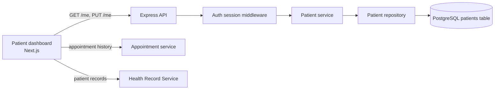
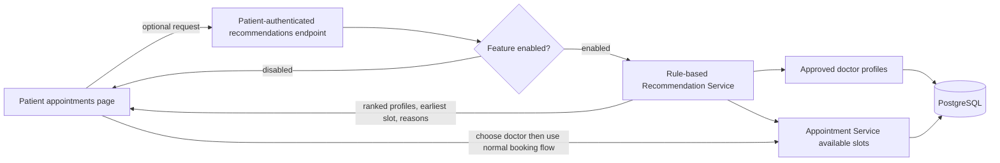
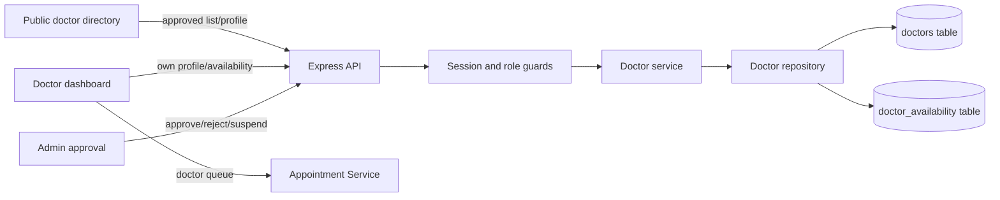
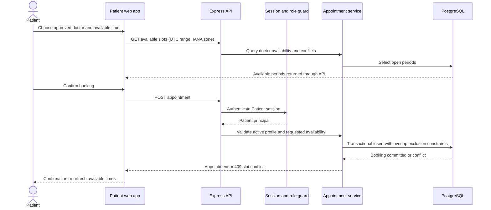
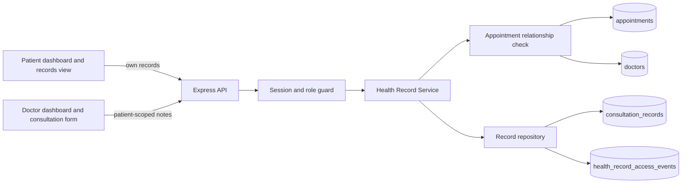
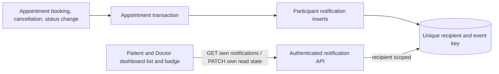
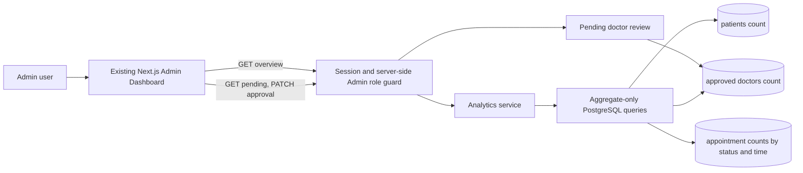

# Smart Healthcare SOA

Smart Healthcare is a web-first service-oriented system using npm workspaces with a Next.js/React/TypeScript web client, an Express/TypeScript API, a shared API contract package, and PostgreSQL.

## Feature status

This matrix describes capabilities represented in the current repository. “Implemented” means the code paths and user-facing workflow exist; it does not certify a production deployment or verify that local provider credentials, database migrations, or external services are configured.

| Area | Status | Current capability and boundary |
| --- | --- | --- |
| Auth | Implemented; integrations configuration-dependent | Password/session auth, Patient email verification and password recovery, server-side roles, Admin TOTP MFA, and verified-email Admin MFA recovery are implemented. Google/Facebook sign-in requires provider setup. Phone OTP is not included. |
| Patient | Implemented | Patient profile, appointment, health-record, prescription, report, document, messaging, and notification pages/API exist, with session-derived ownership and relationship checks. Collection pagination is not consistent across every patient-facing list. |
| Doctor | Implemented; license review is manual | Doctor profile, encrypted license submission, Admin evidence-backed review, approval, availability, appointments, records, prescriptions, messaging, and consultations. The app does not query licensing registries automatically. |
| Appointment | Implemented | Patients can book published doctor availability; Doctors can manage appointment status; Admins can schedule, view, reschedule, and cancel. API validation and PostgreSQL overlap constraints guard booking conflicts. Recommendations do not reserve a slot. |
| Health records | Implemented; local legacy conversion completed | New messages, private documents, consultation records, prescriptions, and consultation-note drafts use application-level AES-256-GCM encryption. Readers retain compatibility for older rows. |
| Notifications | Implemented; SMTP-dependent | Selected appointment, reminder, video-room, doctor-joined, message, document, record, prescription, and Admin security events queue private emails. Appointment/doctor-joined alerts also appear in-app. Phone OTP and SMS notifications are not included. |
| Admin | Implemented | Admin analytics, doctor approval, account status controls, TOTP MFA, paginated/filterable account and appointment records, and appointment scheduling exist. Browser verification of the complete Admin workflow is not recorded as complete. |
| Messaging | Implemented | Persistent Patient–Doctor conversations use authenticated REST/Socket.IO, relationship authorization, pagination, read cursors, idempotent sends, and metadata-only access audits. The separate general `/chat` AI placeholder is unavailable. |
| Video | Configuration-dependent | Appointment-linked LiveKit consultation routes and UI exist. Calls require LiveKit configuration; attendance timestamps are client-reported, not provider-verified. |
| AI | Future / unavailable | Prediction endpoints explicitly report that no inference service is configured and do not fabricate results. Rule-based doctor recommendations are optional directory matching, not clinical AI. |
| Scale/deployment expansion | Future work | Native mobile, cloud deployment, containers/orchestration, independent service deployment, and autoscaling are not current implementation scope. |

See [Known implementation gaps](./docs/architecture.md#known-implementation-gaps) and the domain sections below for details and operational caveats.

The matrix was checked against API route/service modules under `services/api/src`, web routes under `apps/web/app`, migrations `001`–`023`, and the API, UI, and end-to-end test sources. These files establish repository behavior only; they do not establish the migration state of a running database or the availability of external providers.

## Requirements

- Node.js 20+
- npm 10+
- PostgreSQL 14+ for authentication, service data, migrations, and demo fixtures

## Setup

1. Install Node.js 20+, npm 10+, and PostgreSQL 14+.
2. On macOS with Homebrew, install and start PostgreSQL 16:

   ```sh
   brew install postgresql@16
   brew services start postgresql@16
   pg_isready -h localhost -p 5432
   ```

   If Homebrew is not available, install PostgreSQL 14 or newer from the official PostgreSQL distribution for macOS, start its local server, and ensure `psql`, `createdb`, and `pg_isready` are on `PATH`.
3. Create the local database only if it is absent. `createdb` does not replace an existing database; it reports an error if the name already exists. With the default Homebrew role, first check and then create as needed:

   ```sh
   database_exists=$(psql -d postgres -tAc "SELECT 1 FROM pg_database WHERE datname='smart_healthcare'")
   if [ "$database_exists" != "1" ]; then createdb smart_healthcare; fi
   ```

   If PostgreSQL uses a different role or password, configure its connection URL only in `.env` and use that local role for `psql`/`createdb`.
4. Copy `.env.example` to `.env` in the repository root. Generate independent random 32-byte keys with `openssl rand -hex 32` for `MEDICAL_DATA_ENCRYPTION_KEYS`, `ADMIN_MFA_ENCRYPTION_KEY`, and `AUTH_OTP_PEPPER`; set the medical keyring as `key-id:<64-hex-character-key>`. Do not reuse keys. Configure SMTP privately for account verification, password recovery, Admin MFA recovery, and selected notifications. For Google and Facebook sign-in, configure provider credentials and register the callback URLs shown in `.env.example`. Keep `.env` ignored by Git and never put credentials in frontend environment variables. The API loads this root file from its workspace regardless of which npm workspace command starts it.
5. Run `npm install` from the repository root.
6. Apply pending migrations with `npm run db:migrate -w @healthcare/api`. Each file is applied once in filename order, transactionally, and recorded with a SHA-256 checksum in `app_schema_migrations`. For a fresh database, the runner initializes the ledger. A populated database without a ledger is rejected; do not rerun historical migrations to “catch up.”
7. Add the synthetic demo accounts and records with `npm run demo:seed -w @healthcare/api`.
8. Run `npm run dev` from the repository root. The API starts at `http://localhost:4000` and the web app at `http://localhost:3000`.
9. Check `GET http://localhost:4000/health` for API liveness. It is process liveness only and does not check PostgreSQL readiness.

### Database migration tracking and historical baselines

The migration runner holds a PostgreSQL advisory lock, checks the contiguous migration ledger and file checksums, and commits each migration together with its ledger entry. A failed migration is rolled back as a unit; previously successful migrations remain recorded. No migration runs at API startup.

To apply up to one specific migration, use its exact filename. Earlier pending migrations are applied first; no migration is skipped:

```sh
npm run db:migrate -w @healthcare/api -- --target=016_medical_data_encryption.sql
```

Databases created before the ledger was introduced need a reviewed baseline. The runner intentionally refuses a populated database with no ledger. Do not guess the last migration from the code, README, or presence of tables. First make a verified backup and restore it into an isolated database. Build a disposable reference database from the migration files through the proposed version, compare full schema-only dumps (accounting only for the expected `app_schema_migrations` table difference), and resolve all differences. The `db:baseline` command also checks required marker columns and refuses a target older than detected markers; these checks are guardrails and do not replace the schema-dump comparison.

Only after that review, record the exact contiguous version through which the restored target schema was verified. For example, if the comparison confirms schema through 015:

```sh
npm run db:baseline -w @healthcare/api -- --through=015_auth_login_rate_limits.sql --confirm-reviewed-schema
```

If schema 016 is already present, baseline through 016 only after confirming its complete schema against the disposable reference. If the actual version or history is ambiguous, stop and resolve it manually; never baseline all migrations by default. Baseline records current migration-file checksums but does not execute their SQL or prove historical data-side effects.

Migration 010 has a historical one-time update for the reserved demo identities. The ledger prevents it from being replayed on ordinary migration runs. The development-only demo seed also marks only those reserved identities verified when it creates or updates the local fixtures. Do not replay migration 010 manually or use a baseline as a substitute for reviewing the existing data state.

For the controlled medical-data deployment and backup/restore runbook, see [docs/medical-data-deployment.md](./docs/medical-data-deployment.md). This project provides application-level encryption, not end-to-end encryption; the server can decrypt content during authorized operations.

### Local environment verification

Verification updated on 2026-10-22 in the current macOS environment:

- PostgreSQL 16 was installed with Homebrew and its service is running. `pg_isready -h localhost -p 5432` reported that it accepts connections. The `smart_healthcare` database was absent before setup and was created; no existing database was overwritten or deleted.
- Migrations 001–006 were applied successfully, then `demo:seed` completed successfully. The seed uses the synthetic local-only data listed below. A root `.env` copied from `.env.example` is ignored by Git and contains local development configuration only.
- Live API verification succeeded for Patient, Doctor, and Admin login and server-returned roles; own patient profile and records; patient appointments and notifications; doctor profile, queue, and authorized records; approved doctor directory and available slots; Admin analytics; and denial of unauthenticated, patient-to-admin, and doctor-to-patient-profile requests.
- A database-backed workflow succeeded: the Patient booked an available slot, the Doctor saw and confirmed it, the Doctor created a linked synthetic consultation record, and the Patient read that record and its notification. The first booking exposed a UUID/text comparison bug in notification creation; the repository query was corrected and the complete workflow then passed.
- A live Google Chrome browser workflow against PostgreSQL then repeated sign-in, booking, doctor confirmation, consultation creation, and patient record viewing. A separate temporary Patient account received HTTP 404 when requesting another patient's record. The temporary account was deleted, and the guarded `demo:reset` command was run afterward to restore the reserved synthetic demo baseline.
- API unit/integration tests: **33 passed** (run with permission for local test sockets). Frontend unit tests: **11 passed**. Workspace type check: **passed**. Production build: **passed**, with an existing Autoprefixer warning in `app/globals.css`.
- Playwright E2E: **5 passed** using the installed Google Chrome app and `PLAYWRIGHT_CHROMIUM_EXECUTABLE_PATH="/Applications/Google Chrome.app/Contents/MacOS/Google Chrome"`. The tests use mocked API responses; they verify UI behavior, not PostgreSQL persistence. The bundled Chromium download was unavailable because the browser download host could not be resolved. To use installed Chrome, run:

  ```sh
  PLAYWRIGHT_CHROMIUM_EXECUTABLE_PATH="/Applications/Google Chrome.app/Contents/MacOS/Google Chrome" npm run test:e2e -w @healthcare/web
  ```

- An opt-in live PostgreSQL browser test is available at `apps/web/e2e/database-workflow.spec.ts`. It covers the Patient-to-record workflow and cross-patient denial, rejects public role escalation, races two synthetic Patients for one slot, and verifies doctor recommendations in both feature-flag modes. With recommendations enabled, the Patient selects a recommendation, a second synthetic Patient occupies the selected slot, the first booking receives `409 SLOT_UNAVAILABLE`, then booking succeeds after the competing test appointment is cancelled. With recommendations disabled, the UI shows the disabled message and the Patient completes the ordinary directory booking flow. It requires `RUN_DATABASE_E2E=true`, `NODE_ENV=development`, and a `DATABASE_URL` whose host is loopback and database name is exactly `smart_healthcare`. It creates uniquely named synthetic Patient accounts and cleans up only rows owned by those accounts. It uses the seeded approved Doctor and needs an available seeded slot; run the guarded `demo:reset` command first if those fixtures are missing. The Playwright config starts fresh API and web servers so each run uses the requested recommendation flag; choose unused ports. With the root `.env` loaded, run twice:

  ```sh
  set -a
  . ./.env
  set +a
  NODE_ENV=development RUN_DATABASE_E2E=true DOCTOR_RECOMMENDATIONS_ENABLED=false WEB_PORT=3213 API_PORT=4213 WEB_ORIGIN=http://localhost:3213 NEXT_PUBLIC_API_URL=http://localhost:4213 PLAYWRIGHT_CHROMIUM_EXECUTABLE_PATH="/Applications/Google Chrome.app/Contents/MacOS/Google Chrome" npm run test:e2e -w @healthcare/web -- --grep @database
  NODE_ENV=development RUN_DATABASE_E2E=true DOCTOR_RECOMMENDATIONS_ENABLED=true WEB_PORT=3214 API_PORT=4214 WEB_ORIGIN=http://localhost:3214 NEXT_PUBLIC_API_URL=http://localhost:4214 PLAYWRIGHT_CHROMIUM_EXECUTABLE_PATH="/Applications/Google Chrome.app/Contents/MacOS/Google Chrome" npm run test:e2e -w @healthcare/web -- --grep @database
  ```

  When the opt-in flag is absent, the database workflow test is skipped. Its cleanup is transactional and limited to the generated user IDs and emails; unrelated demo accounts and rows are not reset.
- On 2026-10-22, the original opt-in PostgreSQL workflow passed twice. After extending it with concurrent booking and role-escalation checks, the updated opt-in workflow passed **1/1**; the normal browser suite passed **5/5 with the database test skipped**, web unit tests passed **11/11**, and workspace type checking passed. Aggregate database checks confirmed that no temporary E2E users or appointments remained beyond the seeded demo baseline.
- On 2026-10-22, the recommendation-enabled and disabled PostgreSQL browser workflows each passed **1/1** on separate ports. The enabled pass verified a recommended doctor, stale-slot `409` feedback, and successful booking after releasing the synthetic competing appointment; the disabled pass verified the standard directory booking path. Generated E2E users and appointments were both **0** after cleanup. Frontend unit tests passed **14/14**; the slot-conflict error regression is covered directly. Workspace type checking and production build are recorded after rerun below.

- The API `/health` endpoint and web home page returned HTTP 200. Port 3000 is occupied by a pre-existing Next.js process that serves HTTP 404 for the app routes. The repository's web app is available on port 3002 with its matching API on 4001; these use `WEB_ORIGIN` and `NEXT_PUBLIC_API_URL` values aligned to those ports. To run this pair on this host, use separate terminals:

  ```sh
  API_PORT=4001 WEB_ORIGIN=http://localhost:3002 npm run dev -w @healthcare/api
  NEXT_DIST_DIR=.next-local-3002 NEXT_PUBLIC_API_URL=http://localhost:4001 npm run dev -w @healthcare/web -- --port 3002
  ```

  The existing listener on port 3000 was left untouched. The stock root `npm run dev` command still targets ports 4000/3000 and requires port 3000 to be free. The repository folder has no `.git` metadata in this environment, so tracked-file status could not be checked; `.gitignore` excludes `.env`, and `.env.example` contains only local configuration defaults. A pattern scan found no common private-key or cloud access-key material in the source tree (excluding dependencies and the ignored `.env`).

### Local demo accounts and reset

The seed file creates synthetic local-only accounts with public demo credentials. The names, contact details, notes, diagnosis, and appointment data are fabricated. These credentials are intentionally disposable, are not production secrets, and must never be reused outside a local demo.

| Role | Email | Password |
| --- | --- | --- |
| Patient | `demo.patient@example.test` | `LocalPatient!2026` |
| Doctor | `demo.doctor@example.test` | `LocalDoctor!2026` |
| Admin | `demo.admin@example.test` | `LocalAdmin!2026` |

The first Admin sign-in requires enrollment in an authenticator app and saving the displayed recovery codes. These public demo credentials are only for the disposable local database; do not reuse them elsewhere.

Demo seeding and reset are restricted by the script to `NODE_ENV=development` and database name `smart_healthcare`. Re-running the seed refreshes the reserved demo profiles and appointments; use the reset command after a hands-on demonstration to clear its reserved records and restore the initial state:

```sh
npm run demo:reset -w @healthcare/api
```

This command removes the reserved demo accounts and records linked to those synthetic Patient and Doctor identities, then reseeds them; unrelated rows are not erased. It resets changes made during the demo, including appointments and consultation records created for the demo accounts. For a complete local database reset, first verify the configured `DATABASE_URL` points to the disposable local database, then run `dropdb smart_healthcare` followed by `createdb smart_healthcare`, migrations, and `demo:seed`. Never run the database drop commands against a shared or non-local database.

To use another local API URL in the browser, set `NEXT_PUBLIC_API_URL` in `apps/web/.env.local`; the frontend otherwise defaults to `http://localhost:4000`. Do not put credentials in frontend environment variables.

## API foundation conventions

- API responses use `{ success, data?, error?, meta? }`; errors use stable `{ code, message, details? }` fields and include a generated `meta.requestId`.
- Add route validation with `validateRequest({ body?, params?, query? })` from `services/api/src/middleware/validate-request.ts`. Route handlers consume parsed values from `res.locals.validated`. Validation errors expose field paths and generic issue descriptions, never rejected values.
- Logs are newline-delimited JSON generated by the allowlisted logger. Request logs contain request ID, method, Express route template (never concrete record/user IDs), status, and duration. Do not add request/response bodies, headers, user identifiers, credentials, or clinical details to logs.
- The API allows credentialed CORS only for the configured `WEB_ORIGIN`; the development web and API use the same `localhost` hostname so `SameSite=Lax` session cookies work across ports.
- The root `.env.example` contains development defaults only and no database or service credentials. Add a new API setting to the Zod schema and example together when a later phase needs it.

`GET /health` is process liveness only. It does not claim database readiness.

## Workspace layout

- `apps/web`: Next.js user interface.
- `services/api`: Express API entry point, middleware, and routes.
- `packages/shared`: shared response and health contracts.
- `docs/architecture.md`: requirements, service ownership, roles and permissions, planned database design, API conventions, diagrams, scope, and implementation log.

## Authentication API

Apply `services/api/migrations/001_auth.sql` to PostgreSQL before starting the API. The API requires `DATABASE_URL`; configure `SESSION_COOKIE_SECURE=true` when running behind HTTPS. Sessions use random opaque tokens in an `HttpOnly`, `SameSite=Lax` cookie; only a SHA-256 digest is stored in PostgreSQL. Passwords use bcrypt hashing. Set the secure-cookie flag in production.

| Method and path | Purpose | Access |
| --- | --- | --- |
| `POST /api/v1/auth/register` | Create an unverified Patient account and send an email verification code | Public; rejects any additional fields such as `role` |
| `POST /api/v1/auth/login` | Verify credentials; start a Patient/Doctor session or return an Admin MFA challenge | Public |
| `POST /api/v1/auth/email/verification/request` | Send a verification code when the address belongs to an active unverified account | Public |
| `POST /api/v1/auth/email/verification/confirm` | Verify an email code and create the session | Public |
| `POST /api/v1/auth/password/reset/request` | Send a reset code to an active account with verified email | Public; generic response |
| `POST /api/v1/auth/password/reset/confirm` | Consume a reset code, update the password, and revoke existing sessions | Public |
| `GET /api/v1/auth/oauth/google/start` | Begin Google OpenID Connect authorization with state, nonce, and PKCE | Public; provider credentials required |
| `GET /api/v1/auth/oauth/facebook/start` | Begin Facebook authorization-code sign-in with state and a browser-bound flow cookie | Public; provider credentials required |
| `POST /api/v1/auth/logout` | Revoke current session and clear its cookie | Authenticated |
| `GET /api/v1/auth/me` | Return current user identity and role | Authenticated |
| `POST /api/v1/auth/mfa/setup` | Return a one-time TOTP seed and authenticator setup URI for an Admin enrollment challenge | Admin password verified; short-lived challenge cookie |
| `POST /api/v1/auth/mfa/verify` | Verify TOTP or one-time recovery code and create the authenticated session | Admin password verified; short-lived challenge cookie |

Login, registration, logout, and current-user responses use the common `{ success, data, meta }` envelope. Authentication failures return generic messages. Session cookies are sent with `credentials: "include"` from the web app. Role assignment to `Doctor` or `Admin` must be performed by a trusted administrative provisioning process; public registration cannot set roles. Never use the client-side dashboard route as an authorization check.

Admin accounts require TOTP MFA after a correct password. Their initial login returns a short-lived, HttpOnly challenge cookie instead of an authenticated session. The Admin can scan the QR code shown during enrollment or enter its manual setup key in an authenticator app, then verify a current 6-digit code (30-second period). Retrying setup during the same enrollment returns the same pending seed, so it does not invalidate a code from an already-scanned QR code. Later sign-ins require a fresh TOTP code or one of the 10 one-time recovery codes. Recovery codes are displayed once after enrollment; save them securely. There is no password-only or email-only MFA bypass. Challenges expire after five minutes, codes are single-use, and ten failed MFA codes within 15 minutes temporarily lock verification for 15 minutes. Migration `009_admin_totp_mfa.sql` marks all pre-existing sessions as not MFA-verified, so existing Admin sessions cannot access the Admin API; they must sign in and enroll first. Session creation and API session lookup also require enabled MFA for Admins.

TOTP secrets are encrypted with AES-256-GCM using `ADMIN_MFA_ENCRYPTION_KEY`. Admins who lose authenticator access can request an email recovery code through the password-authenticated MFA challenge; recovery removes current MFA sessions and codes, then requires fresh authenticator enrollment. SMTP must be configured for this recovery path. Doctor license numbers are encrypted with the medical-data keyring, and Admin verification requires a recorded official registry URL/reference. The review is manual; no registry API is integrated. Production startup rejects missing encryption keys, insecure session cookies, or non-HTTPS public URLs.

The API provides reusable `requireAuthenticated`, `requireRoles`, and `requireResourceOwner` middleware in `services/api/src/auth/authorization.ts`. Resource owners must be resolved from server-side data, not trusted from a client-provided role or arbitrary ownership claim.

The web sign-in page routes the user to `/patient`, `/doctor`, or `/admin` based on the server-returned role. These pages are presentation destinations only; protected data and actions must still be guarded by API middleware.

The public home page links to dedicated `/signin` and `/signup` pages. `/signup` creates Patient accounts only and requires a code sent to the submitted email before a session is created. Email codes are hashed with `AUTH_OTP_PEPPER`, expire after 10 minutes, allow up to five attempts, and delivery is limited to five codes per account per hour. Password reset only sends codes to verified email addresses; responses are generic to avoid account enumeration, and successful resets revoke existing sessions. Phone-based OTP is not enabled.

Google sign-in uses authorization-code OIDC, state, nonce, PKCE, Google JWKS signature/issuer/audience validation, and verified provider email. Facebook sign-in exchanges an authorization code server-side, uses the same browser-bound state cookie, and fetches the provider account ID and email with an app-secret proof; sign-in requires Facebook to return an email. Both callbacks must match the browser that initiated the flow before a server-side flow is consumed. OAuth accounts are Patient by default; an identity can be linked to an existing account only when its email is verified. Existing Admin accounts still complete TOTP MFA after provider authentication. Set `API_PUBLIC_URL` to the API origin and register `/api/v1/auth/oauth/google/callback` and `/api/v1/auth/oauth/facebook/callback` with the providers. The sign-in page offers Google and Facebook buttons. Facebook setup requires `FACEBOOK_APP_ID` and `FACEBOOK_APP_SECRET`; `FACEBOOK_GRAPH_API_VERSION` selects the Graph API version (defaults to `v26.0`). Production requires OTP pepper and SMTP delivery settings; when OAuth is enabled in production, `API_PUBLIC_URL` must use HTTPS.

The Patient dashboard at `/patient` includes a Patient profile section. It reads the signed-in Patient's profile from `GET /api/v1/patients/me`, displays name, date of birth, phone, and address, and supports completing or editing those fields with `PUT /api/v1/patients/me`. The API derives the profile owner from the authenticated session.

## Patient service

Apply `services/api/migrations/002_patients.sql` after the auth migration. The patient profile is linked to the authenticated `users.id`; clients cannot select a patient/user ID. Only an active `Patient` session can call these endpoints:

| Method and path | Purpose |
| --- | --- |
| `GET /api/v1/patients/me` | Return the caller's profile, or `profile: null` and `complete: false` if not yet completed |
| `PUT /api/v1/patients/me` | Create a first profile or update the caller's existing profile |

Profile fields are `givenName`, `familyName`, `dateOfBirth` (past ISO date), `phone`, and optional `addressLine`, `city`, `postalCode`. Inputs reject unknown properties and apply bounds at the API and database layers. The API resolves ownership from the authenticated session and only queries/updates that user's row.

The patient dashboard supports profile completion and editing, loading, empty, success, and error/retry states. It includes a real appointment summary/history link to `/patient/appointments` and a health-record link at `/patient/records`.



## Doctor service

Apply `services/api/migrations/003_doctors.sql` after the auth and patient migrations. Doctors are linked one-to-one to `users.id`. New profiles start `pending`; only `approved` profiles appear in public directory responses. Editing a previously approved profile returns it to `pending` for re-approval. Public directory results omit account identifiers and return only public profile fields and future availability. Migration 014 adds optional location, consultation-mode, fee, and synthetic-demo metadata used by recommendations.

| Method and path | Purpose | Access |
| --- | --- | --- |
| `GET /api/v1/doctors/directory?specialization=` | List up to 100 approved doctors, optionally exact-filtered by specialization | Public |
| `GET /api/v1/doctors/directory/:id` | Read an approved public doctor profile | Public |
| `GET /api/v1/doctors/me` | Read own profile and availability | Doctor |
| `PUT /api/v1/doctors/me` | Create/update own professional profile | Doctor; approval status and ownership are not accepted from input |
| `PUT /api/v1/doctors/me/availability` | Replace own future availability periods | Doctor |
| `GET /api/v1/doctors/pending` | List up to 100 pending doctor profiles for review | Admin |
| `PATCH /api/v1/doctors/:id/approval` | Approve, reject, or suspend a doctor profile | Admin |
| `GET /api/v1/doctors/recommendations?specialization=&city=&mode=&maxFee=&from=&to=` | Return up to 10 eligible doctors with an unbooked period, filtered by supplied preferences and ordered by specialization match then earliest available time | Patient; opt-in feature |

Profile fields: `givenName`, `familyName`, `specialization`, optional `qualification`, optional `experienceYears` (0–60), and optional `bio`. Availability is an array of future ISO timestamps (`startsAt`, `endsAt`), with end after start, no overlaps, and at most 50 entries per update. A write replaces future saved availability. Appointment booking is implemented by the Appointment service: patients book within published availability, while Admins can schedule for a patient after checking a doctor's availability. A recommendation or availability check is not a reservation; booking and Admin scheduling revalidate the selected interval, and PostgreSQL constraints protect against overlapping active appointments. Doctors can update only the profile and availability associated with their authenticated session. Admins can review pending profiles in the Admin dashboard and approve, reject, or suspend them; the review list omits the linked user account ID.

### Optional rule-based doctor recommendations

Set `DOCTOR_RECOMMENDATIONS_ENABLED=true` in the ignored root `.env` to enable the recommendation endpoint; it is disabled by default. A disabled endpoint returns `{ "enabled": false, "recommendations": [] }`, while public directory, profile, availability, and booking behavior remains available. The Patient appointments page has a separate optional “Find doctors” control and explains when recommendations are disabled.

When enabled, `GET /api/v1/doctors/recommendations` accepts optional exact `specialization`, `city`, `mode` (`video` or `in_person`), `maxFee`, and offset-bearing `from`/`to` preferences. The default time window is now through 30 days; the maximum is 90 days. Results are limited to 10 profiles with an actually open slot in the requested window. Exact case-insensitive specialty matches rank first, then earliest available slot, then stable doctor ID. Fee is a filter only, not a quality score; experience is not used to rank. The response contains supported modes, location, optional fee, a synthetic-profile flag, and reasons grounded in the filters and availability. It does not use patient records or make clinical suitability claims. Selecting a recommendation does not reserve a slot; the existing appointment API rechecks the selected mode, published availability, and conflicts at booking time.

### Supplied synthetic doctor dataset

The vendored source is [`services/api/seeds/data/synthetic_doctors_200.json`](./services/api/seeds/data/synthetic_doctors_200.json), extracted from the supplied `synthetic_doctors_200_bundle.zip`. It contains exactly 200 profiles with unique `DOC-DEMO-*` IDs and `example.test` addresses, 20 specialties and cities, synthetic experience/fees, consultation modes, and date/time availability in `Asia/Kolkata`. Dataset validation runs before import and rejects malformed data, duplicate IDs/emails, unsupported modes/timezones, and invalid time intervals. The source has inconsistent weekday labels in its slot records (515 of 600 do not match their ISO date); the importer intentionally derives availability from ISO date + local time + timezone, never from the unreliable weekday label.

The web app includes a generated illustrative avatar for each of these 200 sample profiles and displays it in the directory and profile page. These images are illustrations, not photographs or identity evidence. Keep the synthetic/demo disclosure visible anywhere these sample providers are shown; they must not be represented as real or verified clinicians.

After migrations are applied, run `npm run synthetic:doctors:import -w @healthcare/api`. Import is idempotent, upserts only rows marked with this dataset's stable synthetic ID, refuses email collisions with non-synthetic accounts, and is guarded to `NODE_ENV=development|test` plus a loopback database named exactly `smart_healthcare`. Seed-created Doctor users have randomly generated, discarded passwords and are not login credentials. Their profiles and all related recommendation/booking UI must show **Synthetic demo profile · not a verified healthcare provider**. They are bookable only in development/test so local demonstrations can exercise the ordinary appointment conflict checks; they cannot represent real care providers. Production queries and booking reject synthetic profiles even if a development database is copied into production.

To remove only unreferenced imported demo profiles, run `npm run synthetic:doctors:remove -w @healthcare/api` against the same guarded local database. It refuses to remove profiles linked to appointments, clinical records, prescriptions, documents, or audit events. Disable recommendations independently with `DOCTOR_RECOMMENDATIONS_ENABLED=false`; disabling recommendations does not delete seed rows.



No recommendation table or migration is required. The feature is stateless and can be disabled at any time without changing doctor or appointment workflows.

## Appointment service

Apply `services/api/migrations/004_appointments.sql` after migrations 001–003. All timestamps are instants with explicit offsets in requests and UTC ISO-8601 values in responses and storage. Collection queries accept optional `from` and `to` offset timestamps plus an IANA `timeZone` (validated; defaults to UTC); `from` is inclusive and `to` is exclusive. The browser sends its IANA time zone and formats UTC instants locally. This avoids interpreting local wall times as server-local times.

| Method and path | Purpose | Access |
| --- | --- | --- |
| `GET /api/v1/appointments/available-slots?doctorId=&from=&to=&timeZone=` | Find approved doctor availability not occupied by an active appointment | Public |
| `POST /api/v1/appointments` | Book a whole published availability period (`doctorId`, `startsAt`, `endsAt`) | Patient |
| `GET /api/v1/appointments/me?from=&to=&timeZone=` | List the caller's appointments/history | Patient |
| `GET /api/v1/appointments/doctor/me?from=&to=&timeZone=` | List the authenticated doctor's assigned appointment queue | Doctor |
| `POST /api/v1/appointments/:id/cancel` | Cancel a booked/confirmed appointment (`reason` optional) | Owning Patient or assigned Doctor |
| `PATCH /api/v1/appointments/:id/status` | Set an allowed next state (`confirmed`, `completed`, `no_show`) | Assigned Doctor |

Booking requires a currently published availability period that contains the requested time range. The database uses PostgreSQL exclusion constraints over half-open `tstzrange` ranges to prevent overlaps for both doctors and patients, including concurrent requests. The service returns `409 SLOT_UNAVAILABLE` on constraint conflicts. Status changes and audit history rows are committed together. Allowed transitions: `booked → confirmed` or `cancelled`; `confirmed → completed`, `no_show`, or `cancelled`; terminal states cannot transition further. Cancellation is available to the owning patient or assigned doctor while active. No queues or cloud dependencies are introduced.

### Appointment feedback and public doctor ratings

Migration `017_appointment_feedback.sql` adds one feedback row per appointment. Only the authenticated patient who owns a completed appointment may submit a 1–5 star rating and a trimmed comment (up to 2,000 characters); feedback cannot be edited or submitted twice. `GET /api/v1/feedback/me` returns only the caller's feedback, and `POST /api/v1/feedback/appointments/:appointmentId` creates it. Authenticated Doctors can use `GET /api/v1/feedback/doctor/me` and `/doctor/feedback` to read feedback only for appointments assigned to their own account. Approved public doctor profiles expose only aggregate `ratingAverage` and `ratingCount`; no review text or patient identity is returned publicly. The Patient appointments history displays the form after completion, and the video consultation page links patients to it when the visit ends.

On a legacy database without a migration ledger, follow the reviewed backup and schema-comparison procedure in the database migration section before applying migration 017. The doctor directory remains available without ratings if the feedback table is not yet present; submissions require migration 017.





## Health Record Service

Apply `services/api/migrations/005_health_records.sql` after migrations 001–004 for structured consultation records. Migration 014 adds appointment-scoped private document metadata and access auditing; there is no public object-storage service or public file URL.

| Method and path | Purpose | Access |
| --- | --- | --- |
| `GET /api/v1/records/me` | List the authenticated patient's consultation records | Patient; own records only |
| `GET /api/v1/records/me/:id` | Read one of the authenticated patient's records | Patient; own record only |
| `GET /api/v1/records/doctor?patientId=` | List records for a patient with a confirmed or completed appointment relationship | Approved Doctor assigned to that patient |
| `POST /api/v1/records/doctor` | Create note/diagnosis, optionally linked to a matching confirmed/completed appointment | Approved Doctor assigned to that patient |

Create body fields: `patientId` (required UUID), `appointmentId` (optional UUID), `consultationAt` (optional ISO timestamp with offset), `note` (required, 1–10,000 characters), and `diagnosis` (optional, up to 2,000 characters). Server-side authorization verifies the Doctor is approved and has an appointment relationship to the patient. When linked, the appointment must match both doctor and patient and be confirmed or completed. Patients cannot read records belonging to other patients; doctors cannot query unrelated records. Record bodies are not included in request logs.

Every successful list, read, and create writes a `health_record_access_events` row with actor, patient, record where relevant, action, request ID, and time. The audit table intentionally excludes note and diagnosis text. Denied access does not disclose record existence. The database model links records to `patients.user_id`, `doctors.id`, and optionally `appointments.id`; composite constraints ensure a linked appointment matches both record participants and restrict deletion while the consultation references it. Records are read-only to patients in this phase; correction/amendment policy remains future work.

### Private appointment documents

Migration 014 adds `appointment_documents` and metadata-only `appointment_document_access_events`. Authenticated patients and doctors can use these appointment-scoped endpoints:

| Method and path | Purpose | Access |
| --- | --- | --- |
| `GET /api/v1/appointments/:appointmentId/documents` | List filenames, media types, sizes, uploader display names, timestamps, and permitted-delete state | The Patient or assigned Doctor only |
| `POST /api/v1/appointments/:appointmentId/documents` | Stream one PDF, JPEG, or PNG using `Content-Type` and `x-file-name` headers | The Patient or assigned Doctor only |
| `GET /api/v1/appointments/:appointmentId/documents/:documentId` | Download as an attachment | The Patient or assigned Doctor only |
| `DELETE /api/v1/appointments/:appointmentId/documents/:documentId` | Remove the caller's own upload before the appointment starts | Original uploader only; appointment must remain booked/confirmed |

The default private local storage directory is `.private-documents` under the API working directory; set `DOCUMENT_STORAGE_DIR` to choose another private path. Files are written with restrictive directory/file permissions and random server-generated UUID keys; neither filesystem paths nor storage keys are exposed. Uploads are bounded at 10,000,000 bytes by default (`DOCUMENT_MAX_BYTES`, configurable from 1 MiB through 25 MB), validated against filename/extension/MIME and PDF/JPEG/PNG signatures, then encrypted before a file is persisted. Database metadata and access events exclude file contents. Admins are denied by default. Once an appointment starts, deletion is disabled to preserve a minimal consultation record; the database retains a tombstone and audit entry after a permitted file removal.

### Medical-data encryption and migration

Message contents, private document bytes, consultation records, prescriptions, and consultation-note drafts use Node.js AES-256-GCM with unique 12-byte nonces, authenticated context, and a versioned `shc1` envelope. Structured clinical fields are bundled into an authenticated encrypted payload before PostgreSQL persistence. Existing plaintext rows remain readable for migration compatibility, but are not automatically converted at startup. Migrations 016 and 022–023 add format/version metadata and envelope constraints; they do not encrypt existing content. The current local database has been converted and reports no plaintext messages, clinical records, prescriptions, or consultation drafts.

`MEDICAL_DATA_ENCRYPTION_KEYS` is required in every environment and is separate from Admin MFA and OTP keys. Its comma-separated format is `active-key-id:<64 hex characters>,older-key-id:<64 hex characters>`; the first key encrypts new data and all listed IDs can decrypt old data. Keep keys in a secret manager in production, protect key backups separately from database/file backups, and ensure every API replica uses the same keyring. Losing a key makes payloads encrypted with that key unrecoverable. This is server-side application encryption, not end-to-end encryption; an authorized server can decrypt content. Database/disk/backup encryption-at-rest remains a separate deployment responsibility.

Apply schema migrations 016 and 022–023 through the normal reviewed database migration process first; they add format/version metadata and envelope constraints but do not convert existing content. Deploy the encryption-capable API to every replica before accepting writes; older API instances continue to create legacy plaintext rows/files. Then use the explicit conversion tool, which is report-only by default and uses bounded batches:

```sh
npm run medical-data:encrypt -w @healthcare/api
```

After verifying restorable database and private-file backups, a local development migration requires `--apply --confirm-backup`; production additionally requires `--allow-production`:

```sh
npm run medical-data:encrypt -w @healthcare/api -- --apply --confirm-backup
npm run medical-data:encrypt -w @healthcare/api -- --rotate
npm run medical-data:encrypt -w @healthcare/api -- --rotate --apply --confirm-backup
```

Do not use apply flags without an approved change window and verified recovery plan. The tool verifies encrypted documents before updating metadata/removing the plaintext original and can resume after interruption. For rotation, first configure the new active key plus all previous keys on every API replica and wait until all instances use that same keyring; then run the same tool with `--rotate` (and the same backup acknowledgements) to re-encrypt old-key payloads. Confirm no payloads use old key IDs before removing old keys. Once encrypted writes exist, an older plaintext-only application binary cannot safely read them; use a forward-compatible rollback/recovery release. Never run migration automatically at startup.



## Notification Service

Apply `services/api/migrations/006_notifications.sql` after migrations 001–005. Appointment booking, cancellation, and status changes create notifications for the patient and doctor in the same transaction as the appointment change. Unique `(recipient_user_id, event_key)` keys plus `ON CONFLICT DO NOTHING` make event retries safe. Messages contain appointment update text only, not diagnosis or consultation notes.

| Method and path | Purpose | Access |
| --- | --- | --- |
| `GET /api/v1/notifications/me?limit=50&beforeCreatedAt=...&beforeId=...` | List a cursor-paginated page and the accurate total unread count | Any authenticated user; own notifications only |
| `PATCH /api/v1/notifications/:id/read` | Mark a notification read; repeat calls preserve the original read time | Authenticated owner only; another user's ID returns 404 |

The Patient and Doctor dashboards show unread badges and recent in-app notifications. The unread count is queried independently of the visible page. A background email outbox delivers appointment lifecycle events, 24-hour reminders, video-room opening alerts, doctor-joined notices, new-message/document/record/prescription alerts, and Admin account/security notices. Emails contain generic event text and direct users to sign in; clinical message/record/document contents are not included. Delivery requires SMTP and a verified active recipient account. Failed sends retry with backoff up to five attempts. SMS and phone OTP are not included.



## Admin analytics

The Admin Dashboard is part of the existing Next.js app at `/admin`; it uses the aggregate analytics module in the Express API. The endpoint is available only to an active authenticated account whose server-resolved role is `Admin`:

| Method and path | Purpose | Access |
| --- | --- | --- |
| `GET /api/v1/analytics/overview` | Return patient profile count, approved doctor count, total appointments, counts by appointment status, booked appointments awaiting confirmation, and future booked/confirmed appointments | Admin only |

The response contains counts and a generation timestamp only. It omits patient names and IDs, doctor identities, diagnoses, consultation notes, and other clinical record content. Pending counts include booked appointments whose start is still in the future; upcoming counts include future booked or confirmed appointments. The dashboard provides loading, error/retry, refresh, responsive metric cards, and an appointment status table. A separate Admin-only doctor approval queue lists pending professional profiles and supports approve, reject, or suspend actions; the queue omits linked user account IDs.



### Admin account controls and service status

The Admin dashboard provides email search, role/status filters, and 25-row pagination over user accounts, and allows an Admin to set an account to active, inactive, or locked. Registered-patient and approved-doctor views apply server-side profile filters and show paginated, clickable records with a detail panel. Admins can page and filter appointment records by status and date range; clicking a row opens its details. It does not create accounts or change user roles. The API prevents an Admin from disabling their own account or the last active Admin. Account-status changes and doctor approval decisions are written transactionally to `admin_audit_events` (migration `008_admin_audit.sql`) with the actor, target, before/after status, and request ID.

`GET /api/v1/admin/services` probes the API and PostgreSQL, reports AI inference as unavailable until an adapter exists, and reports whether SMTP, Google OAuth, Facebook OAuth, and LiveKit settings are present. `configured` means required environment fields are present; it does not mean a provider connection or complete sign-in/video workflow was verified. Provider values are never returned by this endpoint.

### Prescriptions, reports, and optional integrations

Migration `007_prescriptions.sql` adds persisted prescriptions and access events. Patients can read their own prescriptions at `GET /api/v1/prescriptions/me`. Doctors can read prescriptions for a patient with `GET /api/v1/prescriptions/doctor?patientId=` and create one with `POST /api/v1/prescriptions/doctor`; creation requires an approved Doctor and a confirmed/completed appointment connecting that Doctor to the same Patient. Both prescription workspaces are linked from the dashboards.

The Patient Reports pages display and print stored consultation records through the existing patient-scoped records API; they do not generate independent reports or downloadable documents. Date/category filtering is not yet available.

The `/ai`, `/ai/[feature]`, `/doctor/ai-predictions`, and `/chat` pages are integration-status placeholders. Authenticated AI prediction and patient chat requests return an explicit `503` while no inference/chat provider is configured; chat messages are not sent to an external service or stored. Medical-image analysis is unavailable. These pages do not fabricate predictions, diagnoses, or chatbot responses.

The current Admin account controls do not include user creation, role assignment, or an audit-event browser. Account recovery, additional clinical record categories, report filters, and appointment rescheduling/detail workflows are also not part of this increment.

## Integration and security review

The connected API workflow test uses synthetic in-memory repositories and exercises patient registration/login, own-profile completion, approved-doctor discovery, slot lookup and booking, doctor queue/confirmation, consultation creation, patient-owned record retrieval, and patient notification listing. Service-specific tests additionally cover role escalation, inactive/invalid authentication, cross-patient record denial, unapproved directory filtering and booking rejection, concurrent booking, and invalid appointment transitions. Record uploads are not enabled; the service stores structured consultation text only.

Security review notes: request schemas reject undeclared fields; registration assigns Patient server-side; private routes use session-derived roles and resource ownership; request/error logs use an allowlist and omit request bodies, credentials, IDs, and medical content; generic errors do not serialize exceptions. The in-memory workflow test does not validate PostgreSQL behavior or browser dashboard refresh. Those checks remain pending until npm and PostgreSQL are available.

## Web UI conventions and accessibility

- Patient, Doctor, and Admin workspaces use shared `DashboardNav` navigation, consistent title spacing, dashboard cards, buttons, and feedback styles. Patient appointment and record pages mark the current navigation item with `aria-current="page"`.
- Use semantic landmarks and heading order, labels for every form control, table headers for tabular data, descriptive names for repeated actions, and `role="status"` or `role="alert"` for asynchronous feedback. Loading, empty, error/retry, and success states should remain understandable without color alone.
- Keep keyboard focus visible on links, buttons, inputs, textareas, and selects. Respect reduced-motion preferences and allow dashboard navigation to wrap on narrow viewports. Navigation visibility is presentation only; API authorization remains mandatory.
- Extend the existing stylesheet in `apps/web/app/globals.css` before introducing UI packages. Patient records and appointment data stay in their service-owned areas; Admin analytics displays aggregates only.
- Playwright smoke checks live in `apps/web/e2e`; run `npm run test:e2e -w @healthcare/web` after installing dependencies and Chromium with `npx playwright install chromium`. These checks mock service responses and cover patient, doctor, and Admin dashboards, patient slot booking, doctor consultation entry, keyboard focus, responsive overflow, and the Admin table; API authorization is tested separately.

## Checks

- `npm test -w @healthcare/api`: API unit and in-memory integration tests.
- `npm test -w @healthcare/web`: web component tests.
- `npm run test:e2e -w @healthcare/web`: Playwright smoke suite; install its browser first with `npx playwright install chromium`.
- `npm run typecheck`: TypeScript checks across workspace packages.
- `npm run build`: production builds for shared contracts, API, and web app.
- `npm run db:migrate -w @healthcare/api`: apply all SQL migrations to the configured PostgreSQL database.

AI is intentionally not part of the current workflow. If added later, inference will live in an optional Python/FastAPI service so core healthcare features remain available without it. Native mobile apps and cloud deployment/scaling are future-report items only; they are not included in the local demo.

### Local verification results (2026-10-22, expanded portal work)

- `npm run typecheck`: passed for shared, API, and web workspaces.
- `npm test -w @healthcare/api`: passed, 14 files / 46 tests.
- `npm test -w @healthcare/web -- --reporter=dot`: passed, 7 files / 16 tests.
- `npm run build`: passed for shared, API, and web. Next.js emitted the existing non-blocking Autoprefixer warnings for `align-items: end`.
- `npm run db:migrate -w @healthcare/api`: applied migrations 001–008 successfully to the configured local `smart_healthcare` PostgreSQL database, including the new prescriptions and Admin audit tables. No reset or seed command was run.
- The guarded PostgreSQL/Chrome recommendation workflow passed **1/1** with recommendations disabled and **1/1** enabled. The two modes ran on separate ports against the local `smart_healthcare` database; generated E2E users and appointments were cleaned up by the test.
- The local API and Next.js development server were started on `http://localhost:4001` and `http://localhost:3002`; `GET /health` and the web home page both returned HTTP 200. The PostgreSQL migration command had already succeeded. The servers are left running for the local demo.

### Admin TOTP MFA

- Admin password login now yields only a five-minute HttpOnly MFA challenge. Initial login requires authenticator enrollment; later logins require a fresh TOTP or unused recovery code before an Admin session is created.
- TOTP seeds are AES-256-GCM encrypted at rest. Existing Admin sessions are marked unverified by migration 009; database session creation/lookup rejects Admin sessions that are not MFA-verified and enabled.
- MFA challenges are single-use, TOTP steps cannot be replayed, recovery codes are one-time, and ten failed MFA codes within the failure window trigger a temporary lock.
- API unit tests cover enrollment, role-protected Admin session issuance, recovery-code reuse denial, rate limiting, and RFC 6238 TOTP vectors. Frontend tests cover enrollment and recovery-code acknowledgement.
- A temporary synthetic Admin was used for live HTTP/API plus PostgreSQL checks of enrollment, verified session creation, unverified legacy-session rejection, replay/recovery handling, and throttling; its user and dependent rows were removed afterward. Migration 009 was run twice successfully to verify safe repeatability.
- `npm run typecheck`, all API tests (51), all web tests (17), and production build passed. A type-check run parallel to a build once hit a Next.js generated-type cleanup race; rerunning type-check after the build passed.

If all authenticator devices and recovery codes are lost, Admins can use a code sent to their verified email after password sign-in, then must enroll a new authenticator. This recovery requires SMTP and invalidates existing Admin sessions and recovery codes. Preserve the MFA encryption key in secure backups. This is not a claim of regulatory or production security certification.

### Admin scheduling, video, and messaging

- Migrations 011–015 add appointment type/notes, consultation lifecycle metadata and note drafts, durable Patient–Doctor conversations/messages/read cursors, metadata-only access audits, synthetic doctor metadata, private appointment-document records, and PostgreSQL-backed login-attempt buckets. Later migrations add identity recovery and email-outbox notifications. Apply migrations with `npm run db:migrate -w @healthcare/api`.
- Admins can schedule, list, reschedule, and cancel appointments through `/api/v1/admin/appointments`. The Admin scheduler checks a selected interval against the doctor's published availability, appointment mode, acceptance status, and active bookings. Filters support specialization, city, minimum experience, and maximum fee; unavailable doctors show the conflicting appointment time and patient name. The final create/reschedule operations recheck published availability, while PostgreSQL exclusion constraints remain authoritative for overlapping appointments. Admin overview count cards open filtered patient, approved-doctor, appointment, pending, and upcoming record lists. Participant overlaps are rejected by the existing database constraints. Admin-only notes are not included in patient or doctor appointment responses.
- Admin appointment and user records use offset pagination (25 rows by default, up to 100 per page) and server-side role/status/profile/date filters. Very deep offsets may become slower at large scale; cursor pagination is a future performance upgrade. Patient records shown in the overview are account/profile metadata, not clinical records; clinical records retain their separate resource-level authorization.
- Video rooms use LiveKit. Set `LIVEKIT_URL`, `LIVEKIT_API_KEY`, and `LIVEKIT_API_SECRET` privately in the root `.env`; leave all three unset to keep video unavailable. `TELECONSULTATION_JOIN_WINDOW_MINUTES` controls how early participants may join (default 15 minutes). The patient waiting room refreshes join status every five seconds; the transactional email outbox also sends a generic room-opening email and a doctor-joined email when SMTP is configured. Email delivery is best-effort and cannot block a consultation.
- Only the assigned Patient and Doctor can receive a room token. Admins may view consultation metadata but cannot join. Audio/video is not recorded by this application. The API records client-reported join timing, not a provider-verified webhook event; do not treat those timestamps as proof of attendance.
- Doctors can save consultation note drafts and finalize a patient-visible summary after ending an active video consultation. Internal notes are restricted to the assigned Doctor. Finalized summaries are immutable in this workflow and appear in the patient's health records.
- Patient–Doctor messaging is available at `/patient/messages` and `/doctor/messages`. Migrations 012–013 add durable care conversations, messages with client-generated idempotency keys, per-user read cursors, and access metadata audit events (conversation/action/actor/request ID only, never message text). Conversations are created from confirmed/completed appointments; every REST request and Socket.IO subscription/send/read event rechecks the signed-in Patient or assigned Doctor against that care relationship. Administrators have no messaging access by default.
- Messaging history is cursor-paginated (`before` sequence, `limit` 1–100), message bodies are limited to 4,000 characters, unread counts are per participant, and HTTP sends remain available when the realtime connection is offline. Socket.IO authenticates the existing HttpOnly session cookie and automatically reconnects; the web client reloads persisted history and re-subscribes after reconnecting.
- REST messaging endpoints are `GET /api/v1/chat/conversations`, `GET /api/v1/chat/conversations/{id}/messages`, `POST /api/v1/chat/conversations/{id}/messages` (requires `clientMessageId` UUID and `message`), and `POST /api/v1/chat/conversations/{id}/read`. Socket events are `conversation:join`, `message:send`, `message:new`, and `conversation:read`.
- Message sends are limited to 30 per user per minute per API process. This in-memory limit is appropriate for the current single-process local setup; it is not a distributed limiter. Message bodies are not included in application request logs.
- Password login permits up to 10 attempts per normalized account and observed source address in a 15-minute window. Migration 015 stores only an HMAC digest of the pair and an expiry; PostgreSQL makes the limit shared across API instances. Valid credentials clear that pair's bucket. Production instances must share `AUTH_OTP_PEPPER`. Configure only trusted proxy IPs/CIDRs in `TRUSTED_PROXY_ADDRESSES`; never trust arbitrary forwarded headers or use `*`. This pairwise limit is not a substitute for ingress protection against distributed credential stuffing.
- Message and document application-level encryption is implemented for new writes, with legacy plaintext reads until the separately run migration completes. This is not E2EE. Database/storage/backup encryption-at-rest depends on deployment configuration. Production must terminate TLS at a trusted ingress for HTTPS and WSS and set `SESSION_COOKIE_SECURE=true`; never expose database or document storage publicly.
- The opt-in synthetic PostgreSQL messaging integration test runs only against a loopback `smart_healthcare` database and creates/removes only its own synthetic users and appointment. With the root `.env` loaded, run:

  ```sh
  set -a
  . ./.env
  set +a
  RUN_DATABASE_CHAT_TESTS=true CHAT_DATABASE_URL="$DATABASE_URL" npm run test -w @healthcare/api -- --reporter=dot -t "PostgreSQL doctor-patient messaging"
  ```

- The synthetic doctor import and removal commands are `npm run synthetic:doctors:import -w @healthcare/api` and `npm run synthetic:doctors:remove -w @healthcare/api`; both are guarded to development/test loopback `smart_healthcare`. The supplied 200 profiles are fictional and never verified providers.
- Private appointment document upload/list/download and guarded pre-appointment deletion are implemented in migration 014; prescription lifecycle changes remain outside this task.

### Production readiness notes

- Set the web app's `NEXT_PUBLIC_API_URL` in its build environment to the public API HTTPS origin. Production web builds fail if this value is missing or not HTTPS; local development continues to default to `http://localhost:4000`. Next.js embeds this public URL in the client bundle; it is not a secret and must not contain credentials. The API independently requires secure session cookies, HTTPS `API_PUBLIC_URL`, HTTPS `WEB_ORIGIN`, MFA encryption key, OTP pepper, and SMTP delivery in production. When LiveKit is configured in production, `LIVEKIT_URL` must use WSS.
- Configure secrets through the deployment secret manager, not source control or client-side variables. Preserve `ADMIN_MFA_ENCRYPTION_KEY` in protected backups; losing it prevents decrypting stored Admin TOTP seeds. Plan PostgreSQL backups, retention, and tested restore procedures before production use.
- Terminate HTTPS at a trusted ingress and ensure Socket.IO uses WSS. Keep the database and document directory private. New document bytes are application-encrypted; protect private storage and backups separately. Application-level encryption is not end-to-end encryption or proof of disk/backup encryption.
- SMTP is required for account registration and email verification/password recovery. Google/Facebook OAuth require provider credentials and callback registration. LiveKit requires all three provider settings; video is unavailable if any are absent. These integrations are optional outside the corresponding workflows.
- Application logs use an allowlist and omit request/response bodies, credentials, and query strings. `/health` checks process liveness only, not PostgreSQL readiness. Messaging throttling remains in-memory per API process and requires a shared limiter for multi-process deployments. Login limiter bucket hashes expire within 15 minutes; rotating `AUTH_OTP_PEPPER` invalidates current buckets, not user credentials.

### Local verification results (2026-10-21)

- `npm install --ignore-scripts --no-audit --no-fund` completed and generated the root `package-lock.json` (290 packages added). Install scripts were skipped; the required app build and test commands were run separately.
- `npm test -w @healthcare/api`: passed, 10 test files / 33 tests.
- `npm test -w @healthcare/web -- --reporter=dot`: passed, 5 test files / 9 tests.
- `npm run typecheck`: passed for shared, API, and web workspaces.
- `npm run build`: passed for shared, API, and web. Next.js logged a non-blocking attempt to refresh optional SWC lock entries while npm registry DNS was unavailable; it compiled and completed. CSS also emitted an `align-items: end` compatibility warning.
- `npm run test:e2e -w @healthcare/web`: attempted with local server access; Playwright stopped before executing the five scenarios because Chromium is not installed. `npx playwright install chromium` was attempted but the 186 MB download reached 10% and was stopped after stalling.
- `env NODE_ENV=development DATABASE_URL=postgresql://localhost:5432/smart_healthcare npm run db:migrate -w @healthcare/api` exited 1 with `ECONNREFUSED`; the local environment has no `psql`, `createdb`, `dropdb`, or `pg_isready` binaries. `demo:seed` was verified to refuse a database named anything other than `smart_healthcare`. Migrations, seed SQL, and reset SQL were not applied/executed because PostgreSQL is unavailable; run them after starting PostgreSQL.

### Additional verification (2026-10-23)

- `npm run typecheck`: passed for shared, API, and web workspaces after the security changes.
- `npm test -w @healthcare/api -- --reporter=dot`: final post-change run passed 74 tests, with two guarded PostgreSQL integration tests skipped by default; both guarded tests passed separately against local PostgreSQL.
- `npm test -w @healthcare/web -- --reporter=dot`: passed, 9 files / 19 tests, including recommendation selection and unavailable-slot handling.
- `NEXT_PUBLIC_API_URL=https://api.example.test npm run build`: passed for shared, API, and web using an HTTPS placeholder origin to validate build configuration. Next.js emitted the existing non-blocking CSS Autoprefixer compatibility warnings; rebuild with the deployment API URL before starting a production web server.
- `npm run db:migrate -w @healthcare/api`: applied migrations 001–015 to the verified local development database `localhost/smart_healthcare`.
- The guarded synthetic doctor import ran twice; a database count verified 200 rows, 200 distinct dataset IDs, and 200 synthetic profiles.
- The guarded PostgreSQL messaging test passed (1/1), verifying persistence, deduplication, pagination, participant authorization, read cursors, and metadata-only audits against PostgreSQL. Its synthetic test users and appointment were cleaned up by the test.
- The mocked Playwright browser suite passed (5/5; one guarded database test skipped), covering Patient/Doctor/Admin dashboard UI, a mocked patient booking, and a mocked Doctor consultation. The shared browser loaded the public home page on port 3002; the API health endpoint on port 4001 returned HTTP 200.
- The opt-in registration-based PostgreSQL/browser workflow was attempted but stopped at Patient registration: the API returned 503 because SMTP/email delivery is not configured. No test account or appointment was created by that attempt. This did not verify new-account registration/verification or the subsequent workflow; separate live checks using existing synthetic demo fixtures are recorded in the 2026-10-23 section below. API tests and mocked UI tests do not substitute for those live checks.
- The local HTTP session cookie is not marked Secure because this is development. Prompt 18 now encrypts new message/document writes at the application layer; legacy plaintext remains until the separately approved migration is run. PostgreSQL and backup encryption-at-rest remain unverified.
- OAuth callback binding and login-throttling regression tests passed. The guarded PostgreSQL limiter test verified shared state across two limiter instances and cleanup after a successful credential check; the final full API run passed 74 tests, with the messaging and login-limiter database tests skipped by default (each passed 1/1 when run with its local guard enabled).
- A temporary API instance using the updated code returned health HTTP 200 and rejected unauthenticated recommendations with HTTP 401; that instance was stopped afterward. The previously running demo API at port 4001 and frontend at port 3002 remained available.
- Live Playwright checks used the already-seeded synthetic Patient and Doctor accounts without rerunning the upsert seed. Patient and Doctor sign-in, permitted profile/appointment/record reads, Patient recommendation-disabled UI, and Doctor assigned appointment/record access passed. A Patient was denied Admin APIs (403); unauthenticated protected endpoints returned 401; logout restored 401 access.
- With recommendations enabled on an isolated API instance, a signed-in Patient received 10 synthetic recommendations; specialization, city, consultation mode, fee, and availability filters returned the selected profile, and repeated ranking was deterministic. The Patient selected a recommendation, booked a live available slot, and the appointment was visible to the Patient; test bookings were cancelled afterward and retained as cancelled synthetic appointment rows.
- Patient and Doctor exchanged two synthetic messages over Socket.IO; the recipient saw the incoming message live, and history remained after reload. A synthetic PDF uploaded to the demo appointment was downloadable by its assigned Doctor, while an unrelated appointment ID returned 404. The test file was removed; its metadata remains soft-deleted. No real patient content was used.
- Admin sign-in reached the required MFA-enrollment challenge; MFA was not enrolled and existing Admin security state was not changed. Admin management/analytics actions after MFA remain unverified. New self-registration still returns HTTP 503 because there is no SMTP sink/configuration, so email verification, password recovery, and a second newly registered Patient remain unverified. No account was created by the failed signup.
- At the Prompt 17 audit, SMTP, Google/Apple OAuth, LiveKit, and the OTP pepper were unconfigured; LiveKit video and PostgreSQL/backup encryption-at-rest could not be verified. At the start of Prompt 18, two message rows were reported plaintext and the only document metadata row was soft-deleted; the private directory had no files. Prompt 18 adds encrypted writes and migration tooling, but no schema/data migration was run in that task, so those legacy counts must be rechecked with the report-only migration command before planning conversion.
- Production transport checks were tightened: web production builds now reject a missing/non-HTTPS `NEXT_PUBLIC_API_URL`, and API production config rejects `ws://` LiveKit endpoints in favor of `wss://`. Development continues to support localhost HTTP. A production build with an HTTPS placeholder origin passed; deployments must build with their actual API origin.
- Two test-created appointments remain cancelled in the demo Patient history, and two synthetic messages remain in the demo Patient–Doctor conversation. They contain no clinical details. No accounts or existing appointments were deleted or overwritten.

### Application-level encryption update (2026-10-23)

- New message bodies and document uploads are encrypted with AES-256-GCM before PostgreSQL/file persistence. The dedicated keyring is required by API configuration; a random local development key was added to the ignored root `.env` without displaying it. No key is committed.
- API tests passed: 88 passed, with 2 guarded PostgreSQL integration tests skipped. Web tests passed: 19/19. Workspace typecheck and the full shared/API/web production build passed; Next.js reported only the existing CSS Autoprefixer warnings.
- Migration utility unit tests passed for report-only behavior, bounded/idempotent message conversion, interrupted document conversion/resume, plaintext cleanup verification, and key rotation. The CLI was confirmed to reject `--apply` without `--confirm-backup`.
- A read-only database check found 2 message rows, both plaintext, and 1 soft-deleted document metadata row with 0 active documents. The Prompt 18 schema columns are absent, confirming migration 016 has not been applied. No messages, document files, metadata, accounts, or appointments were changed; no real data migration was run.
- The report-only CLI was not run against PostgreSQL because migration 016 is intentionally unapplied. Before conversion, apply schema migration 016 in a planned maintenance window, verify recoverable database and private-file backups, and then run the report-only utility to refresh counts. Database/storage/backup encryption-at-rest was not verified; application encryption is not E2EE.

### Migration-safety implementation (2026-10-24)

- The migration runner now tracks filenames and SHA-256 checksums in `app_schema_migrations`, serializes runners with a PostgreSQL advisory lock, applies each pending migration with its ledger entry in one transaction, and supports an exact `--target` filename. Populated databases without a ledger fail closed.
- Added `db:baseline` for historical databases. It requires explicit schema-review acknowledgement, checks required version marker columns, and rejects a baseline target older than detected markers. Full schema-only comparison against a disposable reference is still mandatory; the command does not establish historical data-only effects.
- Migration 010 retains its historical update, but the ledger prevents replay; the development-only demo seed also writes `email_verified=true` only for reserved synthetic demo identities.
- The conversion utility requires migration 016 to be recorded with the current checksum before it reports or converts. Standard document counts are explicitly identified as metadata-only; rotation inspection authenticates encrypted document files it reads.
- Focused tests passed: 33 tests across migration runner, crypto, conversion, documents, and config. API typecheck and production build passed. PostgreSQL tools/server were unavailable, so no live migration, baseline, real-data report/conversion, backup, or restore was performed. Migration 016 remains unapplied or otherwise unverified in the current environment.

### Database baseline, feedback migration, and verification (2026-10-26)

- The local `smart_healthcare` database had application tables but no migration ledger. With API writers stopped and PostgreSQL reporting no other client sessions, a mode-restricted database archive and private-document archive were created on the FileVault-encrypted local volume. The archive was restored to an isolated database and verified readable; the source private-document directory contained no files.
- A schema-only comparison against disposable migration references matched the restored database exactly through migration 015. Migration 010's reserved demo-account verification update was checked without returning account values; all three reserved accounts were already verified. An isolated restored copy was baselined through 015 and migrated through 016 and 017 before changing the configured database.
- The configured database was baselined through 015, then migrations 016–018 were applied. Its migration ledger now ends at `018_auth_facebook_provider.sql`. The backup and review record are stored under `/Users/azad/Library/Application Support/SmartHealthcareRecovery/database-backup-2026-10-26`; the keyring recovery copy is stored separately under `/Users/azad/Library/Application Support/SmartHealthcareRecovery/migration-20261026`. Both are protected by file permissions and FileVault. These local copies are not an off-device backup.
- Database-backed synthetic feedback checks passed in a transaction that was rolled back: submission returned 201, duplicate submission returned 409, the patient read their own comment, and the public doctor profile returned only its aggregate rating and count. No comments were exposed publicly or retained in the configured database. The live directory returned 201 doctors with aggregate fields and no feedback/comment fields; there are currently zero stored feedback rows, so public profiles correctly show no patient ratings yet.
- The restored database contained two legacy messages, both readable by authorized Patient/Doctor repository paths. It had no active document metadata or files (one deletion tombstone), so a document download restore check was not applicable. No message/document data conversion was run.
- The guarded PostgreSQL messaging integration test initially found a duplicate-send query that omitted `encryption_version`; that query was corrected. Its final run passed (1/1), covering encrypted write/read/idempotent retry and legacy-message reads. The test-created accounts and records were cleaned up.
- Workspace typecheck passed. API tests passed (105; 2 guarded PostgreSQL tests skipped). Web tests passed (24) with one worker; the initial parallel run had one messaging assertion fail, and that test passed when rerun alone. The running local web app and API returned HTTP 200 for `/doctors` and `/health/`.

### Facebook sign-in replacement (2026-10-27)

- Replaced the Apple sign-in button with Facebook and added the Facebook logo. The API now supports Facebook authorization-code sign-in, browser-bound state validation, server-side token exchange, and a Graph API profile lookup requesting only `id` and `email`; provider credentials are read only from the ignored root `.env` and are never logged.
- Added migration `018_auth_facebook_provider.sql` to allow Facebook provider identities while preserving Apple values for existing records. It was applied to the local `smart_healthcare` database; the migration ledger now includes version 018.
- Facebook App ID and App Secret are not configured locally, so a full provider sign-in could not be tested. The endpoint correctly reports Facebook as unavailable until those credentials are added.
- Focused API tests passed (26/26), web auth-panel tests passed (3/3), and API/web typechecks passed. The migration command applied migration 018 successfully.

### Clinical data encryption expansion (2026-10-28)

- New consultation records, prescriptions, and video-consultation note drafts now use the configured AES-256-GCM keyring. Reads decrypt only in the authorized API path; legacy version-0 rows remain readable during migration. Migrations 022–023 were applied to the configured local database.
- The report-only conversion tool now inventories and can convert/rotate messages, records, prescriptions, consultation drafts, and documents in bounded batches. A verified pre-conversion report found 2 plaintext messages and 1 plaintext clinical record; prescriptions and drafts were empty. Two document metadata rows are soft-deleted (one legacy and one encrypted), and the configured private document directory contains no files.
- A fresh mode-restricted backup was written under `/Users/azad/Library/Application Support/SmartHealthcareRecovery/database-backup-2026-10-28` on the FileVault-encrypted volume. Restore to an isolated database matched all 34 public tables, 1,246 rows, and 23 migration ledger entries/checksums. The saved medical-data key matched the configured key without exposing key material. Conversion was first run on the isolated copy, and the resulting encrypted message and record payloads authenticated successfully.
- The configured database conversion encrypted 2 messages and 1 clinical record. The follow-up report shows zero plaintext messages, records, prescriptions, or drafts; all converted payloads authenticated without displaying their contents. No active document rows or files needed conversion. The temporary restore database was removed, and the API was restarted and returned HTTP 200.
- Local volume encryption is verified as FileVault On, and backup files use mode 0600 in a mode 0700 directory. Off-device backup encryption and recovery are not verified. Workspace typecheck passed; automated tests were not run for this update.
