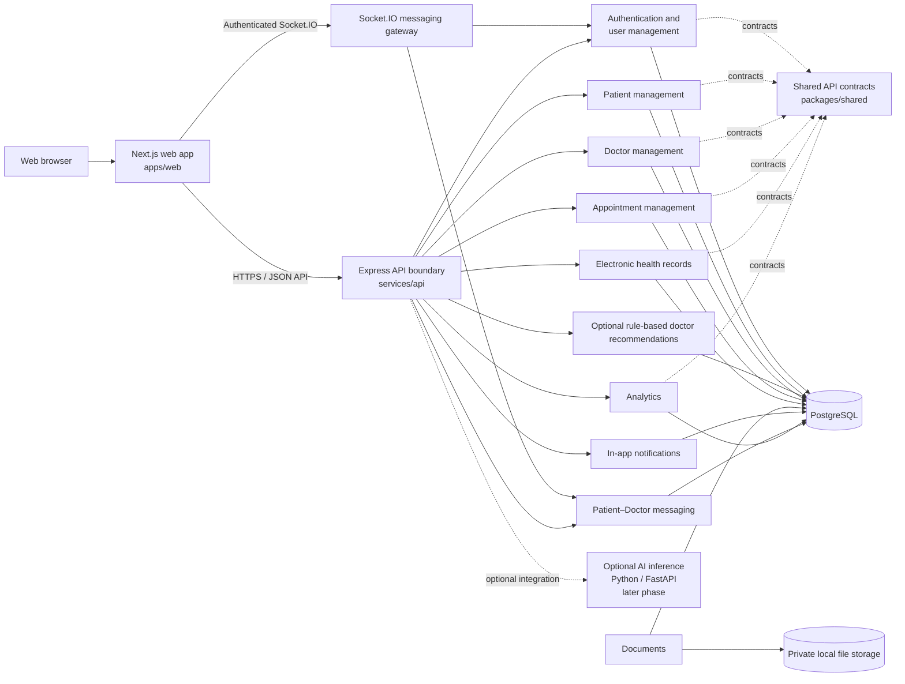
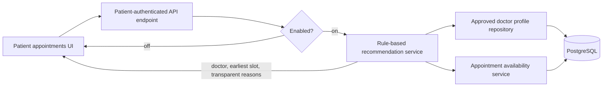
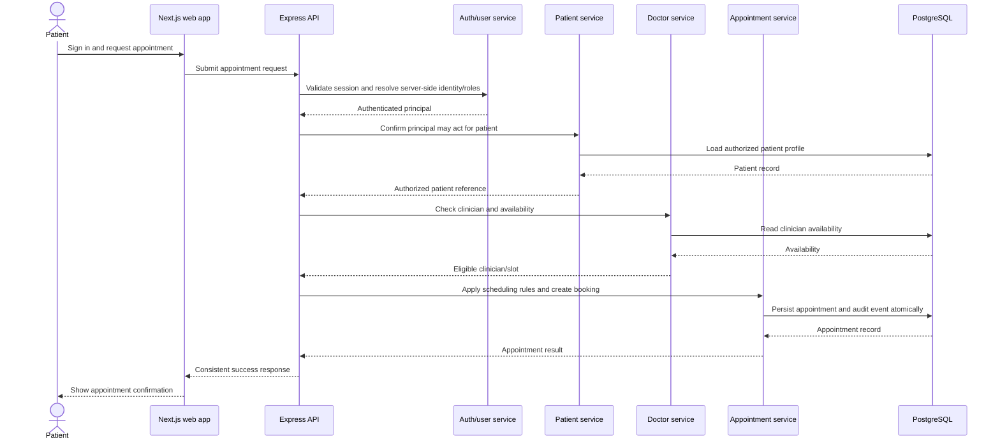

# Requirements and architecture

## Product scope

The Smart Healthcare System is a web-first application for coordinating patient, clinician, appointment, and health-record workflows through a service-oriented API. The first client is a browser-based Next.js application. The core workflows must remain usable independently of optional AI features.

This document describes the implemented system and its remaining planned scope. The current repository includes the Next.js Patient and Doctor workspaces, Express API modules, PostgreSQL persistence, server-side session authorization, appointment-linked teleconsultations, consultation notes, persistent Patient–Doctor messaging, private appointment documents, and opt-in doctor recommendations using clearly labeled synthetic profiles. Historical implementation-log entries below preserve the status recorded when each earlier phase was completed.

### Current feature status

Statuses below describe repository implementation, not production readiness. Provider-dependent features require the corresponding environment configuration; migrations and external integrations must be verified in the target environment.

| Area | Status | Repository evidence / boundary |
| --- | --- | --- |
| Auth | Implemented; integrations configuration-dependent | Password/session routes, Patient email-code workflows, Admin TOTP MFA, OAuth routes, and PostgreSQL login throttling exist. SMTP and Google/Apple provider setup are required for their flows. Phone OTP and self-service Admin MFA recovery are not implemented. |
| Patient | Implemented | Patient profile, appointments, records, prescriptions, reports, notifications, documents, and messaging are present in the web app/API. Pagination is not consistent across all Patient collections. |
| Doctor | Implemented; credential verification partial | Profile, Admin approval, availability, appointment queue/status, care records, prescriptions, messaging, and consultation workflows exist. Professional license verification is outside current functionality. |
| Appointment | Implemented | Patient booking, Doctor appointment lifecycle, and Admin scheduling/list/reschedule/cancel routes exist. Availability is rechecked and database exclusion constraints protect active appointment overlaps. Availability/recommendation results do not reserve slots. |
| Health records | Implemented; encryption coverage partial | Patient/Doctor relationship-scoped record operations and access audits exist. Application-level encryption covers new messages and private document files, not every clinical record or prescription field. |
| Notifications | Partial | Durable in-app appointment notifications are recipient-scoped and markable as read. Listing is capped at 100 and unread count is calculated from that page; high unread volumes can be undercounted. Email/SMS delivery is future work. |
| Admin | Implemented | Analytics, doctor review, account-status controls, MFA, paginated account/appointment record views, and manual scheduling exist. Complete Admin browser workflow verification remains unrecorded. |
| Messaging | Implemented | Patient–Doctor REST/Socket.IO messaging persists messages, enforces care-relationship authorization, supports cursor pagination/read cursors/idempotency, and audits access metadata. The separate general `/chat` AI placeholder is unavailable. |
| Video | Configuration-dependent | Appointment-linked LiveKit token and consultation lifecycle code/UI exist; calls require LiveKit settings. Join timestamps are client-reported, not provider-verified. |
| AI | Future / unavailable | Prediction endpoint is an explicit unavailable response; no inference provider is configured and no results are generated. Optional doctor recommendations are rule-based directory matching, not clinical AI. |
| Mobile and deployment scaling | Future work | Native mobile, cloud deployment, containers/orchestration, independent deployment of service modules, and autoscaling are report-only future scope. |

The status inventory was checked against route/service modules under `services/api/src`, web routes under `apps/web/app`, migration files `001`–`016`, and API, UI, and end-to-end test sources. This is repository evidence only: it does not verify the migration ledger or provider availability in any running environment.

### Functional requirements

1. **Authentication and user management:** authenticate users, manage accounts, and assign server-controlled roles.
2. **Patient management:** create and maintain patient demographics and contact details with access limited by role and relationship.
3. **Doctor management:** maintain clinician profiles, specialties, availability, and status.
4. **Appointments:** request, schedule, view, reschedule, and cancel appointments subject to authorization and scheduling rules.
5. **Electronic health records (EHR):** store and retrieve patient clinical records with resource-level access checks and an audit trail.
6. **Analytics:** provide authorized operational summaries using only the data needed for each report.
7. **Health and diagnostics:** expose a liveness endpoint that does not disclose secrets or patient data. Readiness checks may be added when backing services exist.

### Quality and security requirements

- Validate untrusted input at service boundaries and use database constraints for persisted invariants.
- Enforce role-based and resource-level authorization on the server. Never accept a client-supplied role as authority.
- Do not expose patient records across unauthorized patient, clinician, or administrative scopes.
- Keep secrets in environment configuration; commit only placeholders in `.env.example`.
- Use synthetic demonstration data. Do not place real patient information in fixtures, logs, screenshots, or tests.
- Do not log passwords, tokens, or sensitive medical details. Record security-relevant actions in an appropriately protected audit trail.
- Return consistent API envelopes and safe public error messages; keep internal details out of responses.
- Keep route handling, business rules, and persistence access in separate modules.
- Core workflows must not require AI availability.

## Architecture

The intended deployment shape is a modular web application with separately owned service modules behind the API boundary. Service boundaries are logical ownership and contract boundaries; this design does not require a message broker, service mesh, Kubernetes, or independently deployed microservices.



**Scope statements:**

- **Web app first:** implement and verify browser workflows before considering other clients.
- **AI later:** if introduced, inference will be an optional Python/FastAPI service. Training and experimentation stay separate from inference. Core workflows continue when AI is disabled or unavailable.
- **Mobile and cloud scaling:** native mobile applications, cloud deployment, Docker/Kubernetes, infrastructure scaling, and autoscaling are report-only future work. They are not implementation scope unless explicitly requested later.

### Service ownership

| Service | Owns | Key authorization boundary |
| --- | --- | --- |
| Authentication and user management | Credentials, account lifecycle, role assignment, sessions/tokens | Role assignment and account administration are server-controlled; credential material is never returned |
| Patient management | Patient profile and demographic data | Patient self-access is limited to own record; care staff access is purpose- and relationship-limited |
| Doctor management | Clinician profile, specialty, availability | Only authorized administrators manage clinician identity; clinicians manage permitted profile/availability fields |
| Doctor recommendation | Stateless filtering and ranking of approved profiles by optional specialty, city, consultation mode, budget, and time window | Patient-only endpoint; explains matching filters and earliest slot, labels synthetic profiles, and does not assess clinical suitability |
| Appointment management | Appointment lifecycle, participants, status, scheduling rules | A participant sees only appointments they are allowed to access; staff actions are scoped and audited |
| Appointment feedback | One patient-authored 1–5 star rating and bounded comment per completed appointment; public doctor profiles receive aggregates only | Only the owning authenticated Patient can submit; private feedback listing is patient-scoped and comments are never part of public doctor responses |
| Patient–Doctor messaging | Care conversations, durable messages, pagination, idempotent send, and per-participant read cursors | Every REST action and realtime subscription/send/read is restricted to the authenticated Patient or assigned Doctor with a confirmed/completed appointment; Admin access is not granted by default |
| Appointment documents | Private document bytes and appointment-scoped metadata, listing, download, deletion, and metadata-only access audit | Only the appointment Patient or assigned Doctor may access; Admins are denied; deletion is limited to the uploader before the appointment starts |
| EHR | Clinical notes, diagnoses, medications, and record metadata as phased in | Patient and clinician relationship plus granted role determine access; sensitive reads and writes are auditable |
| Prescriptions | Doctor-issued medication details linked to a patient and qualifying appointment | Only the approved assigned Doctor can create; Patient and authorized Doctor reads are relationship-scoped and audited |
| Notifications | In-app appointment event notifications and per-user read state | Recipients come from appointment participants; users can list and mark read only their own notifications |
| Analytics | Aggregated operational reporting | Reports are role-scoped and minimize or de-identify patient data where individual identity is unnecessary |

Services own their business rules and persistence operations. API routes should validate transport input, call service logic, then serialize the agreed response contract. Shared package types describe contracts; they do not replace runtime validation or authorization.

### Patient–Doctor messaging

Migrations 012–013 create one durable conversation per Patient/Doctor pair, message rows with a server-assigned sequence and sender identity, per-user read cursors, and metadata-only access audit events. A conversation is listed or accessible only while the pair has a confirmed or completed appointment, matching the existing record-service care-relationship policy. The API derives participant identity and role from the HttpOnly session; caller-provided room/conversation IDs are only resource selectors and never authorization. Audit events record actor, conversation, action, and request correlation ID; message bodies are never copied into audit metadata.

REST endpoints:

- `GET /api/v1/chat/conversations` — list authorized care relationships with last message and unread count.
- `GET /api/v1/chat/conversations/{id}/messages?before={sequence}&limit=50` — cursor-paginated history, with a maximum page size of 100.
- `POST /api/v1/chat/conversations/{id}/messages` — send a trimmed message (up to 4,000 characters) with a client-generated UUID idempotency key.
- `POST /api/v1/chat/conversations/{id}/read` — mark the authorized conversation read through its latest persisted sequence.

Socket.IO authenticates the same session cookie. `conversation:join`, `message:send`, and `conversation:read` each independently verify current authorization. Persisted messages are broadcast only after storage; send acknowledgments include the persisted message. Reconnecting clients rejoin authorized conversations and fetch missed history over REST. HTTP send remains available while Socket.IO is offline. The single-process API applies a 30-message-per-user-per-minute in-memory limit; this is not a distributed rate limiter.

New message bodies are encrypted with AES-256-GCM before PostgreSQL persistence. The versioned envelope stores a key ID, random 12-byte nonce, authentication tag, and ciphertext; additional authenticated data binds the content to its conversation, message, and sender IDs. Authorized API code decrypts only after participant authorization, preserving the existing response contract and idempotency behavior. Existing rows marked `encryption_version=0` remain legacy plaintext until the explicit conversion tool is run; new rows are marked version 1. This is application-level encryption, not E2EE.

```mermaid
sequenceDiagram
  participant P as Patient or Doctor browser
  participant API as Express REST API
  participant WS as Socket.IO gateway
  participant Auth as Session authentication
  participant Msg as Messaging service
  participant DB as PostgreSQL

  P->>WS: Connect with HttpOnly session cookie
  WS->>Auth: Resolve current session and role
  Auth-->>WS: Authenticated Patient or Doctor
  P->>WS: Join conversation ID
  WS->>Msg: Recheck appointment relationship
  Msg->>DB: Verify conversation participant and confirmed/completed appointment
  DB-->>WS: Authorized or reject
  P->>WS: Send body and client idempotency UUID
  WS->>Msg: Derive sender from session; validate and rate-limit
  Msg->>DB: Insert once; persist timestamp and sequence
  DB-->>Msg: Persisted message
  Msg-->>WS: Delivery acknowledgment
  WS-->>P: Broadcast message to authorized conversation room
  Note over P,DB: On reconnect, authorized participants reload missed paginated history
```

### Optional doctor recommendation service

The rule-based Doctor Recommendation Service is disabled unless `DOCTOR_RECOMMENDATIONS_ENABLED=true`. When enabled, the authenticated Patient endpoint accepts optional specialty, city, consultation mode, budget, and time-window filters. It ranks eligible profiles deterministically, prioritizes specialty matches, and uses earliest availability and stable identifiers for tie-breaking. Reasons describe matching profile criteria and earliest available time; fees are filters, not quality scores, and experience does not influence ranking. The endpoint does not use patient records or make clinical suitability claims. When disabled, it returns an explicit disabled result, and directory, profile, and booking paths continue to function without it. Synthetic profiles are fictional, visibly labeled, and bookable only in development/test. Recommendations do not reserve slots; the transactional booking endpoint rechecks mode and availability and remains authoritative. Migration 014 stores the profile metadata.

### Private appointment documents

Migration 014 adds appointment-scoped document metadata and metadata-only access audit records. The API streams supported PDF, JPEG, and PNG content into a private local storage directory using random storage keys, restrictive file permissions, configured size limits, and signature checks. The authenticated Patient and assigned Doctor are authorized from the appointment relationship for every list, upload, download, and delete request; Administrators do not receive access by default. A document may be deleted only by its uploader before the appointment starts while the appointment remains booked or confirmed. Audit records contain document/action/actor/request metadata, not file contents.

New document bytes are encrypted with AES-256-GCM before persistence, with the envelope bound to the storage key and media type. The API authenticates the full ciphertext before returning plaintext to an already-authorized participant; it does not write upload plaintext to a temporary file. `storage_format` distinguishes new encrypted files from legacy plaintext files. Existing files remain supported until the explicit conversion tool is run. This is application-level encryption, not E2EE. Production still requires private storage, protected database/file backups, retention controls, key backup/recovery, and TLS at a trusted ingress.

`MEDICAL_DATA_ENCRYPTION_KEYS` is a dedicated comma-separated keyring (`key-id:64-hex-character-key` entries) separate from MFA and OTP secrets. The first key encrypts new payloads; prior key IDs remain available for decryption during rotation. Migration 016 adds the format/version metadata and adjusts the message envelope length constraint; it does not rewrite existing content. The report-only-by-default `medical-data:encrypt` command converts legacy rows/files in bounded, resumable batches after an explicit backup acknowledgement. It can also re-encrypt old-key payloads with `--rotate`. Key loss makes corresponding content unrecoverable. A pre-encryption binary cannot safely be rolled back after encrypted writes; recovery requires a forward-compatible release or an approved restore procedure. No migration was automatically run.

Database migrations are tracked in `public.app_schema_migrations` with migration filename, SHA-256 checksum, and application time. The runner serializes migration processes with a PostgreSQL advisory lock and commits each migration and its ledger entry in the same transaction. It applies only a contiguous pending prefix, rejects unknown or changed applied migration files, and does not run automatically at API startup. Use `npm run db:migrate -w @healthcare/api -- --target=<exact-filename>` to apply up through an exact migration.

For an existing populated database without a ledger, the runner fails closed. Operators must first take and restore a backup in isolation, compare the full schema-only dump against a disposable database migrated to the candidate version, and resolve every difference. `npm run db:baseline -w @healthcare/api -- --through=<exact-filename> --confirm-reviewed-schema` records only that reviewed prefix. Baseline also checks required marker columns and rejects detected later markers, but it does not prove the entire schema or historical data-only effects; the explicit schema comparison remains mandatory. It never executes historical SQL.

Migration 010 retains its historical one-time update for reserved demo identities; the migration ledger prevents replay on ordinary runs. The development-only demo seed also sets verification only for its reserved fixtures. Migration 016 must be applied before the encryption-capable API starts writing. Deploy with all old API writers stopped: encrypted writes are not readable by a plaintext-only release. The database and private document store must be backed up at one quiescent point and restored together in isolation before a conversion is approved. See [the medical-data deployment runbook](./medical-data-deployment.md) for the procedure. Application-level AES-256-GCM is not end-to-end encryption and does not prove disk or backup encryption.



### Patient-to-appointment flow



If any authorization, availability, or persistence check fails, the API returns a safe error envelope and does not create a partial appointment. Implementation must enforce transaction/consistency behavior when the appointment workflow is built.

## Roles and permissions

The role names below are an initial policy proposal. Permission checks must be server-side and combine role permission with resource ownership, care relationship, and applicable consent/purpose rules. A role alone is not blanket access to all patient records.

| Role | Intended permissions | Restrictions |
| --- | --- | --- |
| Patient | Read and update allowed profile fields; view own appointments and permitted own records; request/cancel own appointments under policy | Cannot select or elevate own role; cannot access another patient |
| Doctor/clinician | View records for patients with an authorized care relationship; manage own availability; manage assigned appointments; document care | No unrestricted patient search or unrelated record access |
| Administrator | Manage accounts, role assignments, clinician directory, and operational configuration | Administrative access does not automatically grant clinical-record access; privileged actions require audit |
| Analyst | Access approved aggregate operational metrics | No direct identifiable EHR access by default |
| Service account | Execute a narrowly scoped service integration | No interactive login; least privilege, managed credentials, and audit required |

Unauthenticated requests may use public liveness endpoints only. Denials must avoid confirming whether another user's sensitive record exists where that detail is unnecessary.

## Database design

PostgreSQL is the relational database. The table below summarizes current service schemas and selected access constraints. Store only required data, use UTC timestamps, and define retention/access rules before introducing real data.

| Entity | Key fields and relationships | Notes |
| --- | --- | --- |
| `users` | `id`, normalized unique `email`, password hash or external identity reference, `status`, timestamps | Credentials are never stored in plaintext; separate authentication secrets from profile data where practical |
| `auth_login_attempt_limits` | HMAC digest of normalized account/source-address pair, attempt count, expiration | Migration 015; 10 attempts per pair per 15 minutes; stores no raw email/IP and prunes expired buckets |
| `user_roles` | `user_id`, `role`, assignment metadata | Role writes are privileged and audited; do not trust request payload role values |
| `patients` | `id`, optional unique `user_id`, minimum demographic/contact fields, timestamps | A patient account association is optional; prevent duplicate identity records using an explicit policy |
| `doctors` | `id`, optional `user_id`, specialty, profile status, synthetic dataset marker, location, modes, fee, appointment-acceptance flag | Link clinician login to profile without duplicating credentials; synthetic providers are fictional demos and production queries exclude them |
| `doctor_availability` | `id`, `doctor_id`, start/end, recurrence or slot status | Enforce valid intervals and prevent conflicting bookings transactionally |
| `appointments` | `id`, `patient_id`, `doctor_id`, start/end, status, reason category, created/updated by, timestamps | Foreign keys, valid time range, controlled status transitions, concurrency protection, and audit history |
| `care_conversations` | `id`, `patient_id`, `doctor_id`, timestamps | One conversation per pair; access requires a confirmed/completed appointment |
| `care_messages` | Server sequence, opaque ID, conversation, sender, client idempotency UUID, body, encryption version, timestamp | Sender comes from authenticated session; plaintext input is limited to 4,000 characters; sender/idempotency key is unique per conversation; new bodies use an authenticated AES-256-GCM envelope |
| `care_conversation_reads` | Conversation, participant user, last-read sequence, update timestamp | Composite key stores independent read state for each conversation participant |
| `appointment_documents` | `id`, appointment and participants, uploader, random storage key, filename/type/size, storage format, deletion metadata | Metadata is in PostgreSQL; new file bytes are AES-256-GCM encrypted in private local storage; legacy plaintext files remain marked until explicit conversion |
| `appointment_document_access_events` | Document, appointment, actor, action, request ID, timestamp | Metadata-only audit; never store document bytes or contents |
| `ehr_entries` | `id`, `patient_id`, author user/doctor, type, encrypted or access-protected content, created timestamp | Separate clinical content access from list metadata; audit reads/writes; avoid broad analytics access |
| `audit_events` | `id`, actor, action, resource type/id, timestamp, request correlation ID, minimal metadata | Append-oriented; must not copy passwords, tokens, or unnecessary clinical content into audit metadata |

Use UUID identifiers unless an implementation-specific reason favors another opaque key. Apply foreign keys, `NOT NULL`, uniqueness, checks, and indexes for lookup and scheduling invariants. Define deletion, correction, retention, encryption-at-rest, backup, and audit retention policies before production data. Do not store secrets in source control or migrations.

### In-app appointment notification flow

```mermaid
sequenceDiagram
  participant Actor as Patient or Doctor
  participant API as Appointment API
  participant Appt as Appointment Service
  participant DB as PostgreSQL transaction
  participant Notify as Notification Service
  participant Web as Dashboard notification list

  Actor->>API: Book, cancel, or change appointment status
  API->>Appt: Validate identity, ownership, and transition
  Appt->>DB: Update appointment and append status history
  Appt->>DB: Insert participant notifications with unique event keys
  Note over DB: Appointment change and notifications commit or roll back together
  DB-->>Appt: Commit
  Appt-->>API: Appointment result
  Web->>Notify: GET /api/v1/notifications/me
  Notify->>DB: Select rows for authenticated user only
  DB-->>Notify: Own notifications
  Notify-->>Web: Notification list and unread count
  Web->>Notify: PATCH /api/v1/notifications/{id}/read
  Notify->>DB: Update only when recipient_user_id matches session user
```

The `notifications` table uses a unique `(recipient_user_id, event_key)` constraint. Event keys use appointment ID, event type, and (for status updates) the transition; inserts use `ON CONFLICT DO NOTHING`, so retrying an event cannot create duplicate recipient notifications, while distinct status changes remain visible. Appointment event notifications are inserted in the same transaction as the appointment change. Email is optional future work; paid SMS, Kafka, RabbitMQ, and cloud services are out of scope.

### Notification API

- `GET /api/v1/notifications/me` — authenticated Patient, Doctor, or Admin; returns up to 100 newest notifications and unread count for the current user.
- `PATCH /api/v1/notifications/{id}/read` — authenticated current recipient only; idempotently sets `readAt`. A notification owned by another account returns `404`.
- Booking, cancellation, and status changes notify each appointment participant. Messages contain no clinical note or diagnosis.

## API conventions

### Admin analytics endpoint

- `GET /api/v1/analytics/overview` — active Admin only. Authorization uses the role resolved from the server-side session. The response contains patient profile count, approved doctor count, total appointments, counts by status, future booked appointments awaiting confirmation, future booked/confirmed appointments, and `generatedAt`.
- Queries use aggregate counts only and do not select patient/doctor identifiers or clinical record fields. The existing `/admin` dashboard renders the metrics and appointment status table. Synthetic fixture tests cover calculations in the service response and unauthenticated/non-Admin denials.

### Admin appointment scheduling and records

- `GET /api/v1/admin/appointments/availability` — active Admin only. Requires an interval and appointment type; optional filters cover specialization, city, minimum experience, and maximum fee. Results distinguish available doctors from doctors outside published availability, doctors not accepting appointments, and doctors with an overlapping active appointment. Busy results include the conflicting time and patient display name for operational scheduling.
- `GET /api/v1/admin/appointments` — active Admin only; supports `page`, `pageSize` (1–100, default 25), `view=all|pending|upcoming`, status, and ISO `from`/`to` range filters. The result includes page metadata and only the requested appointments.
- `GET /api/v1/admin/users` — active Admin only; supports the same bounded page controls plus email search, role, account status, patient-profile-complete, and doctor-approval filters. Results include only account/profile metadata needed by the Admin lists.
- Admin appointment creation and rescheduling recheck the doctor's published availability and supported mode. PostgreSQL's exclusion constraints remain the final guard against overlapping patient/doctor bookings under concurrent requests.
- Admin overview metric buttons open paginated, filtered account or appointment records. Patient and doctor rows, appointment rows, and account-list rows open a styled detail view. Patient rows contain account/profile metadata rather than clinical records; clinical record authorization remains separate. Offset pagination has a maximum page size of 100; cursor pagination remains a performance upgrade for very large datasets.

- Prefix versioned business endpoints with `/api/v1`; retain `/health` as an operational liveness endpoint.
- Use resource-oriented nouns and standard HTTP methods/status codes. Use ISO-8601 UTC timestamps and opaque identifiers.
- Validate path, query, and body data at the boundary. Reject invalid fields rather than silently accepting client authority fields such as roles or ownership IDs.
- Authenticate protected routes and authorize each action against the resolved server-side principal and target resource.
- Paginate collection responses with bounded page size; document sorting/filtering for each collection.
- Use an idempotency strategy for retry-sensitive creates when appropriate; use optimistic concurrency or version checks for mutable clinical/scheduling data.
- Return `Content-Type: application/json`, a correlation/request ID, and the response envelopes below. Do not return stack traces or database errors.
- Use `/health` only for process liveness. A later readiness endpoint may report dependency availability without disclosing configuration or connection details.

### Success response

```json
{
  "success": true,
  "data": { "id": "opaque-resource-id" },
  "meta": { "requestId": "opaque-correlation-id" }
}
```

The current shared `ApiResponse<T>` type covers `success` and `data`; `meta` and the error structure are documented target conventions that may be added to the shared contract in an implementation phase.

### Error response

```json
{
  "success": false,
  "error": {
    "code": "VALIDATION_ERROR",
    "message": "The request could not be accepted.",
    "details": [{ "field": "startAt", "issue": "must be a valid future time" }]
  },
  "meta": { "requestId": "opaque-correlation-id" }
}
```

`details` is optional and must contain only safe validation guidance, not submitted sensitive values. Use stable machine-readable codes; example status mapping: `400` validation, `401` unauthenticated, `403` forbidden, `404` unavailable/not found, `409` state or concurrency conflict, `429` rate limited, and `500` unexpected server error. Current API routes use the shared error handler and request IDs; this document retains the response contract for service implementations.

## Implementation log

| Phase | Work recorded | Verification / status |
| --- | --- | --- |
| 1 — Foundation | npm workspace scaffold; Next.js web scaffold; Express API; shared response and health types; Zod environment parsing; `/health`; 404 and generic error responses; `.env.example` | Dependency installation was blocked by unreachable npm registry, including offline cache miss. Tests, type checks, and builds were not run. |
| 1 documentation update | Requirements, proposed service ownership, authorization policy, logical database design, API conventions, role matrix, Mermaid architecture and patient-to-appointment diagrams, scope boundaries | Documentation-only change; no application code changed. |
| 2 — Minimal development foundation | Strict validated API environment settings; shared error envelope; generated request IDs; Zod request validation middleware; allowlisted JSON request/error logger; liveness endpoint metadata; setup guidance and foundation tests | `npm test -w @healthcare/api` attempted but failed because Vitest is not installed. Approved `npm install` attempt stalled without diagnostic output and was stopped; tests/type checks remain unverified. |
| 3 — Authentication and authorization | PostgreSQL auth/session migration; bcrypt password hashing; opaque cookie sessions; register/login/logout/current-user endpoints; authenticated, role, and resource-owner middleware; minimal role landing pages; auth tests and API documentation | `npm test -w @healthcare/api` failed because Vitest is missing; API type check failed because `tsc` is missing. Dependency install stalled. PostgreSQL migration/runtime was not exercised. |
| 4 — Patient service and dashboard | Patient profile table/repository/service; self-only `GET`/`PUT /api/v1/patients/me`; validated minimal profile; dashboard completion/edit, loading/empty/error states; API/UI tests and docs | Pending executable verification; dependencies and PostgreSQL unavailable in this environment. |
| 5 — Doctor service and dashboard | Doctor profile/approval/availability tables; approved-only public directory; Doctor-owned profile/availability updates; Admin approval endpoint; directory/profile/dashboard UI; appointment queue contract later fulfilled by Phase 6 | Pending executable verification; dependencies and PostgreSQL unavailable in this environment. |
| 6 — Appointment service and dashboard integration | PostgreSQL appointment/status-history tables with active overlap exclusion constraints; transactional slot booking and status history; available-slot, booking, patient list, doctor queue, cancellation and transition endpoints; patient booking/history page; dashboard appointment lists; API/UI flow and concurrency tests | `npm install` stalled without output. API/web tests and type checks cannot run (`vitest`/`tsc` missing); PostgreSQL migration/runtime unverified. |
| 7 — Health Record Service | Consultation record model linked to patient, approved doctor, and optional matching appointment; patient-owned read routes; appointment-relationship-scoped doctor read/create routes; metadata-only access audit; patient records view and clinician consultation panel; access-control tests and API/data documentation | npm install stalled; API/web tests failed to start (`vitest` missing), type checks failed (`tsc` missing), PostgreSQL migration verification unavailable. |
| 8 — Notification Service | Transactional participant notifications on appointment create/cancel/status change; own-list and mark-read endpoints; recipient/event uniqueness for retries; dashboard notification list and unread badge; API and Mermaid documentation | Pending executable verification; npm registry and PostgreSQL are unavailable. |
| 9 — Admin Dashboard and Analytics | Existing Admin page now displays aggregate patient, approved doctor, and appointment counts; status breakdown; pending/upcoming counts; Admin-only overview endpoint; fixture-based authorization/response tests; API and Mermaid documentation | Pending executable verification; npm registry and PostgreSQL remain unavailable. |
| 10 — Integration and security review | Added a connected in-memory API workflow test from registration/login through doctor approval, booking, doctor confirmation, consultation creation, patient record view, and notification list; tightened transactional booking to lock and recheck doctor approval; removed internal doctor `userId` from public directory/profile responses and added a regression assertion; documented security review and remaining risks | Test and type check commands attempted but did not start because `vitest` and `tsc` are unavailable. PostgreSQL migration/integration verification remains unavailable. |
| 11 — UI consistency and accessibility | Added shared navigation across Patient, Doctor, and Admin workspaces and patient sub-pages; improved keyboard focus visibility, muted-text contrast, reduced-motion handling, responsive navigation, accessible table naming, doctor record loading feedback, and nested patient route redirection; fixed async consultation form reset; added mocked Playwright dashboard, booking, and consultation smoke tests | Not run: npm dependencies and Playwright Chromium are unavailable due registry/network access. |
| Verification and authorization review | Corrected Express v4 type package, filtered OS environment variables before strict app-config validation, added a test-only database URL setup, aligned API dev hostname with browser origin, enabled credentialed CORS, redacted concrete URL IDs in request logs, made appointment transitions revalidate under row lock, made record creation/audit atomic, corrected API build/typecheck roots | Offline install failed on uncached packages; online registry DNS failed. Tests/type checks and migrations could not run. |
| 12 — Local demo readiness | Root `.env` is resolved reliably from API workspace commands; added ordered transactional migration command, development-only demo seed/reset commands, fabricated Patient/Doctor/Admin accounts with synthetic records, a reset limited to rows linked to reserved demo identities, and reproducible local setup/test instructions. Generated `package-lock.json`; fixed test-only UUID/repository fixture issues and UI test transforms/selectors found during verification. | `npm install --ignore-scripts --no-audit --no-fund` completed (290 packages). API tests 33/33, web unit tests 9/9, workspace typecheck, and production build passed. Build had non-blocking SWC lock refresh/DNS and CSS compatibility warnings. Playwright could not run because Chromium download stalled at 10%. `db:migrate` exited 1 with `ECONNREFUSED`; the demo seed guard correctly refused an alternate database name. PostgreSQL was not available, so migrations and seed/reset SQL remain unverified against a server. |
| 13 — Optional rule-based doctor recommendation | Added opt-in Patient endpoint and stateless service using approved profiles plus Appointment Service's conflict-aware available slots; deterministic ranking and transparent reasons; patient booking UI entry and normal slot selection; validated flag, tests, endpoint docs, and Mermaid service diagram. No schema change. | Historical verification recorded 37 API and 13 web tests passing, workspace typecheck, and production build. |
| 14 — Persistent Patient–Doctor messaging | Added Socket.IO authenticated sessions, PostgreSQL conversation/message/read-cursor persistence (migration 012), metadata-only access auditing (migration 013), appointment-based resource authorization, idempotent sends, cursor pagination, unread counts, rate limiting, patient/doctor messaging pages, appointment/consultation links, and API/architecture documentation. The optional chatbot placeholder remains explicitly unavailable. | Workspace typecheck passed; API tests 63 passed (guarded PostgreSQL test skipped in the default run); web tests 19/19; guarded local PostgreSQL persistence/authorization/idempotency/audit test passed; migrations 012–013 applied; API and web production builds passed. |
| 15 — Secure transport, private appointment documents, and recommendations | Required HTTPS origins and secure session cookies in production; documented TLS/WSS and the absence of application-level/E2E encryption; added private appointment-scoped document storage/API, authorization and metadata-only audits; expanded opt-in recommendations and added migration 014 plus guarded import/removal of the supplied 200 fictional doctors. | Typecheck passed; API 70 passed / 1 guarded PostgreSQL test skipped; web 19 passed; production build passed with existing CSS compatibility warnings. Migrations 001–014 applied to local `localhost/smart_healthcare`; the synthetic import ran twice and verified 200 unique synthetic profiles. No signed-in browser workflow or live document upload/download was run. Local document bytes and message bodies are not application-level encrypted. |
| 16 — Integration, security, and readiness verification | Bound OAuth callbacks to short-lived, per-flow HttpOnly browser state cookies before consuming server-side flow state; added PostgreSQL-backed account/source login throttling with HMAC-only bucket keys (migration 015), trusted-proxy configuration, and OAuth/login throttle regressions; documented transport, encryption, config, logging, health-check, and rate-limit limitations. | API tests 74 passed / 2 guarded tests skipped in the default run; web tests 19/19; workspace typecheck and production build passed; guarded PostgreSQL messaging and login-limit tests each passed 1/1; normal mocked-browser tests passed 5/5 with the DB test skipped. Migrations 001–015 and 200 unique synthetic profiles were verified in local PostgreSQL. The live Patient workflow failed at registration with HTTP 503 because SMTP is unconfigured; no account was created. |
| 17 — Live synthetic workflow and transport verification | Used existing seeded Patient/Doctor fixtures for real browser sign-in, isolated role-scoped API checks, enabled/disabled recommendation flows, a reversible appointment booking/cancellation, persistent Socket.IO message exchange, and private document upload/download with file cleanup. Enforced HTTPS API origins for production web builds and WSS for configured production LiveKit. | Live Patient/Doctor reads, message exchange/reload, recommendation filters/ranking, booking, document authorization, and logout checks passed. New registration remained blocked by missing SMTP; Admin workflow stopped at MFA enrollment to preserve existing Admin state. Typecheck passed; API 74 passed / 2 guarded skipped; web 19/19; mocked Playwright 5 passed / 1 guarded skipped; guarded PostgreSQL messaging/login-limit tests each passed 1/1; production build passed with a placeholder HTTPS API origin. No migration was added. |
| 18 — Application-level medical-data encryption | Added a dedicated AES-256-GCM keyring, versioned message/document envelopes, authenticated record context, encrypted writes, legacy-read compatibility, migration 016 schema metadata, a report-only-by-default bounded conversion/rotation utility, and key backup/recovery guidance. | API tests 88 passed / 2 guarded PostgreSQL tests skipped; web tests 19/19; workspace typecheck and full production build passed. Crypto, document, configuration, migration dry-run/resume/idempotency, and key-rotation unit tests passed. Migration 016 and data conversion were not applied; current database reports two plaintext messages and one soft-deleted document metadata row with zero active rows. |
| 20 — Migration safety and encryption deployment preparation | Added checksummed migration ledger with advisory locking, transactional apply/ledger writes, explicit target selection, fail-closed historical baseline command and schema markers, 016 preflight, conversion ledger verification, migration 010 replay regression coverage, and coordinated backup/restore deployment runbook. | 33 focused API tests passed; API typecheck/build passed. PostgreSQL tools/server were unavailable, so no migration, baseline, real-data report, backup, or restore was run. Migration 016 and conversion were not applied. |

The Patient Service owns the `patients` profile row linked one-to-one to `users.id`. Public self-service routes resolve the account from the authenticated session, require the `Patient` role, and expose no caller-selected user ID. Appointment and Health Record services are implemented in Phases 6 and 7; see README endpoint sections for their current contracts.

## Known implementation gaps

- OAuth uses the short-lived browser-bound state cookie in addition to state, nonce, and PKCE; the flow cookie is cleared before the one-time server flow is consumed. No separate database migration is required.
- Password login is throttled to 10 attempts per account/source-address pair per 15 minutes using PostgreSQL. HMAC bucket keys contain no raw account/IP values; successful credentials clear that pair's bucket. API replicas must share `AUTH_OTP_PEPPER`. Configure only trusted ingress addresses with `TRUSTED_PROXY_ADDRESSES`; an ingress-level limit is still recommended against distributed credential stuffing.
- Guarded PostgreSQL messaging tests verify persistence, participant authorization, deduplication, pagination, read cursors, and metadata-only audits. They do not replace a signed-in Patient/Doctor browser exchange.
- The mocked browser suite covers dashboard and selected appointment/consultation UI paths. Separate live browser checks with existing synthetic Patient/Doctor fixtures verified role-scoped reads, recommendations, booking/cancellation, messaging, documents, and logout. The opt-in self-registration scenario still returns `503` because SMTP is not configured, so new-account verification and a second newly registered Patient remain unverified. Admin workflow stops at MFA enrollment; no Admin security state was changed.
- Message rate limiting is in-memory and per API process. It is not a distributed limiter; multi-process deployments need a shared rate-limit store.
- Notification reads return at most 100 recent rows and the current unread count is calculated from those rows, so it can undercount a larger unread backlog. Email/SMS appointment delivery is not implemented. Pagination is also not implemented consistently across every Patient/Doctor collection; high-volume collections should be paginated before larger deployments.
- Doctor profile approval is an administrative workflow, not professional-license verification. A production onboarding process still needs an appropriate identity and credential verification policy.
- New message writes and private document uploads are AES-256-GCM encrypted at the application layer; legacy plaintext remains readable until the explicit conversion utility runs. This is not E2EE, and a server holding configured keys can decrypt the content. Protect keys separately from database/file backups, test key recovery, and plan a forward-compatible rollback before encrypted writes are deployed.
- Migration 016 only changes schema metadata and message envelope capacity; it does not convert existing content. The conversion/rotation utility is report-only by default and requires a verified backup acknowledgement to apply. PostgreSQL/disk/backup encryption-at-rest, retention automation, and deployment-specific private storage controls remain separate operational responsibilities. Prescription drafting/finalization remains outside this implementation. Optional AI/chatbot integrations remain unconfigured.
- Doctor recommendations remain disabled by default. Their stateless implementation queries availability for approved profiles individually (up to 100 directory entries); a larger directory may warrant a batched availability query. A suggested slot can be booked by another patient before selection; transactional booking validation remains authoritative.
- Set `NEXT_PUBLIC_API_URL` in the web build environment to the public HTTPS API origin before production builds. Production web builds reject a missing or non-HTTPS API URL; local development continues to default to localhost. Configured production LiveKit endpoints must use WSS.
- SMTP, Google/Apple OAuth, and LiveKit are unconfigured in the verified local environment. Account registration/email verification and provider sign-in therefore need those services/credentials; LiveKit video is unavailable without all provider settings.
- `/health` is a liveness check, not a database-readiness check. Use an external readiness check for PostgreSQL before routing production traffic. Configure and test database backups and restores; protect the MFA encryption key because loss prevents recovery of encrypted TOTP seeds.
